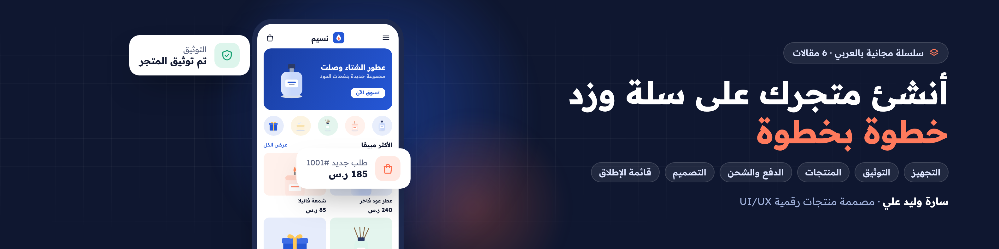
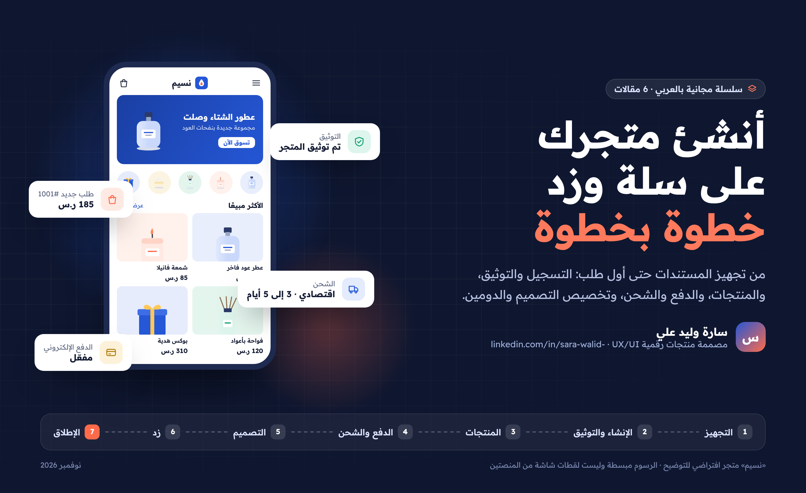

<div dir="rtl">



# أنشئ متجرك على سلة وزد خطوة بخطوة

دليل عملي مجاني بالعربي يأخذك من الصفر حتى متجر إلكتروني جاهز لاستقبال أول طلب على **سلة** أو **زد**: تجهيز المستندات، والتسجيل والتوثيق، والمنتجات، والدفع والشحن، وتخصيص التصميم والدومين، ثم قائمة إطلاق تصلح للمنصتين.

### [اقرأ السلسلة على موقعها ←](https://sarawalidali.github.io/salla-zid-store-setup-guide/)

**6 مقالات · 25 رسمًا توضيحيًا · 6 قوائم مراجعة · مصادر رسمية لكل خطوة**

كتبتها **سارة وليد علي**، مصممة منتجات رقمية UX/UI، تصمم وتخصص متاجر على سلة وزد وShopify للسوق السعودي.

## المقالات

| # | المقال | ماذا ستتعلم | روابط |
| --- | --- | --- | --- |
| 01 | [قبل أن تبدأ: جهّز متجرك قبل التسجيل](articles/01-before-you-start/README.md) | المستندات حسب نوع الكيان، وهوية المتجر، وأول خمسة منتجات، واختيار المنصة والباقة | [اقرأ](https://sarawalidali.github.io/salla-zid-store-setup-guide/01-before-you-start.html) · [Notion](notion/01-before-you-start.zip) |
| 02 | [إنشاء متجرك على سلة وتوثيقه](articles/02-create-salla-store/README.md) | رحلة الإنشاء الخمس، ومتطلبات التدشين، والتوثيق حسب الكيان، وخريطة لوحة التحكم | [اقرأ](https://sarawalidali.github.io/salla-zid-store-setup-guide/02-create-salla-store.html) · [Notion](notion/02-create-salla-store.zip) |
| 03 | [المنتجات والتصنيفات على سلة](articles/03-products/README.md) | حقول المنتج وأين تظهر للعميل، والخيارات وكمياتها، وشجرة التصنيفات | [اقرأ](https://sarawalidali.github.io/salla-zid-store-setup-guide/03-products.html) · [Notion](notion/03-products.zip) |
| 04 | [الدفع والشحن على سلة](articles/04-payments-shipping/README.md) | شروط الدفع الإلكتروني، وطرق الدفع حسب الباقة، وإعداد الشحن الموحد | [اقرأ](https://sarawalidali.github.io/salla-zid-store-setup-guide/04-payments-shipping.html) · [Notion](notion/04-payments-shipping.zip) |
| 05 | [تخصيص تصميم متجرك على سلة](articles/05-design-customization/README.md) | الثيم، والهوية، وعناصر الصفحة الرئيسية، والهيدر والفوتر، والدومين | [اقرأ](https://sarawalidali.github.io/salla-zid-store-setup-guide/05-design-customization.html) · [Notion](notion/05-design-customization.zip) |
| 06 | [نفس الرحلة على زد، وقائمة الإطلاق](articles/06-zid-and-launch/README.md) | زد خطوة بخطوة، ومقارنة المنصتين، والطلب التجريبي، وقائمة الإطلاق | [اقرأ](https://sarawalidali.github.io/salla-zid-store-setup-guide/06-zid-and-launch.html) · [Notion](notion/06-zid-and-launch.zip) |



## كيف تقرأ السلسلة؟

- **أول مرة تنشئ متجرًا:** اقرأ المقالات بالترتيب، وطبّق كل مقال قبل أن تنتقل للتالي.
- **تستخدم زد:** اقرأ المقال 01، ثم انتقل إلى المقال 06. والمقالان 03 و05 مفيدان لك أيضًا لأن مبادئ المنتجات والتصميم واحدة.
- **متجرك موجود وتريد تحسينه:** ابدأ من المقال 05، ثم قائمة الإطلاق في المقال 06.

ولكل طريقة قراءة مكانها:

- **على موقع السلسلة (الأفضل):** فهرس لكل مقال، وتنقل بين المقالات، وصور تكبر عند الضغط، وقوائم مراجعة تعلّم عليها.
- **على GitHub:** افتح أي مقال من الجدول، والصور تظهر داخله.
- **على Notion:** حمّل ملف الـ zip من مجلد [notion](notion/README.md)، واتبع خطوات الاستيراد المكتوبة هناك.

## ملاحظات مهمة

- الخطوات مأخوذة من [مركز مساعدة سلة](https://help.salla.sa/) و[مركز مساعدة زد](https://help.zid.sa/ar) كما كانا في نوفمبر 2026. كل المقالات الرسمية مجمعة في [مصادر السلسلة](SOURCES.md).
- المنصات تحدّث لوحات التحكم باستمرار. إذا اختلف اسم زر، ارجع للمقال الرسمي المرتبط.
- الأسعار والباقات المذكورة كانت وقت الكتابة، وقد تتغير.
- الصور رسومات توضيحية مبسطة لمتجر افتراضي اسمه «نسيم للعطور»، وليست لقطات شاشة من المنصتين.
- السلسلة اجتهاد شخصي للتعليم والمشاركة، وليست صادرة عن سلة أو زد ولا تابعة لهما.

## بعد ما تنشئ متجرك

لو عايز تتعمق في تصميم واجهة المتجر وتجربته، اقرأ سلسلة [تصميم المتاجر الإلكترونية على سلة وزد](https://osa98.github.io/salla-zid-ecommerce-design/) لأسامة عبد الناصر: الصفحة الرئيسية، وقائمة المنتجات، وصفحة المنتج، والسلة، والـ Design System.

## محتويات الريبو

```
articles/   المقالات الست، وكل مقال في مجلده مع صوره
notion/     نسخ جاهزة للاستيراد في Notion
docs/       موقع السلسلة على GitHub Pages
assets/     البانر والبوستر وصورة الغلاف
SOURCES.md  المقالات الرسمية التي اعتمدت عليها السلسلة
```

## عن الكاتبة

**سارة وليد علي**، مصممة منتجات رقمية متخصصة في تجربة وواجهة منصات SaaS والتجارة الإلكترونية. تصمم وتخصص متاجر على سلة وزد وShopify للسوق السعودي، وتعمل على تجربة منصة FalakCart لبناء المتاجر.

- LinkedIn: [sara-walid-](https://www.linkedin.com/in/sara-walid-/)
- Behance: [sarawalid2000](https://www.behance.net/sarawalid2000)

عندك سؤال، أو لاحظت خطوة تغيرت في المنصة؟ افتح [Issue](https://github.com/sarawalidali/salla-zid-store-setup-guide/issues).

## حقوق النشر

© سارة وليد علي، 2026. المحتوى متاح للتعلم والمشاركة مع ذكر المصدر ورابط الريبو. أسماء سلة وزد وشركات الدفع والشحن مذكورة للتعريف فقط، وهي ملك أصحابها.

</div>
