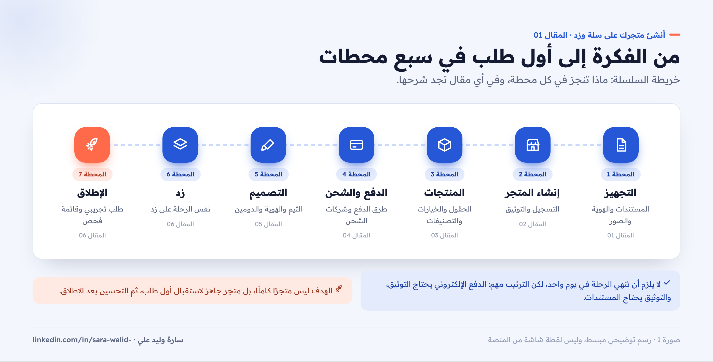
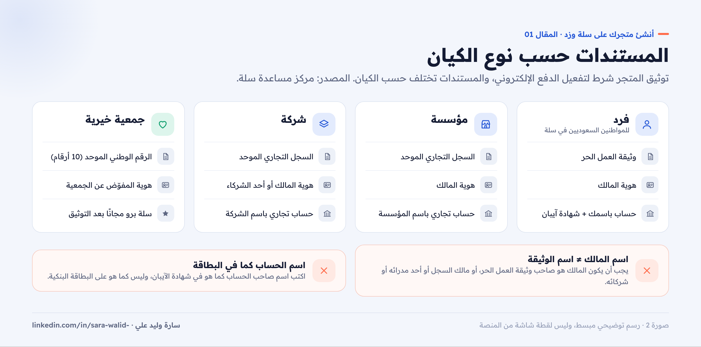
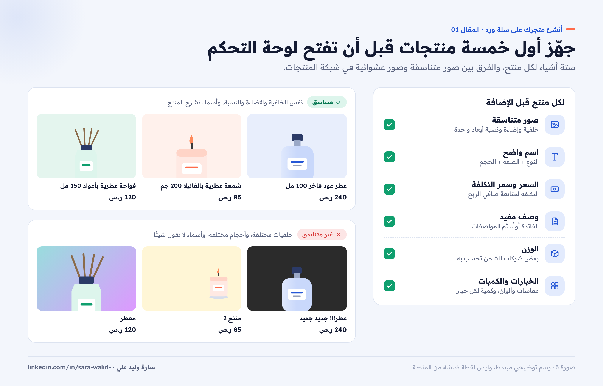

# 01 — قبل أن تبدأ: جهّز متجرك قبل التسجيل

**سلسلة: أنشئ متجرك على سلة وزد خطوة بخطوة · المقال 01**
بقلم: سارة وليد علي · مصممة منتجات رقمية UX/UI · نوفمبر 2026

**[اقرأ المقال على موقع السلسلة ←](https://sarawalidali.github.io/salla-zid-store-setup-guide/01-before-you-start.html)**

> **قبل القراءة:** كل الخطوات في هذه السلسلة مأخوذة من مركز مساعدة سلة ومركز مساعدة زد كما كانت في نوفمبر 2026، ومعها رابط المصدر. المنصات تحدّث لوحات التحكم باستمرار، فإذا وجدت اسم زر مختلفًا، ارجع لرابط المقال الرسمي. الصور في السلسلة رسومات توضيحية مبسطة، وليست لقطات شاشة من المنصتين.

---

## لماذا هذه السلسلة؟

أعمل منذ 2024 على تصميم وتخصيص متاجر لعلامات تجارية سعودية على سلة وزد وShopify، وأصمم تجربة منصة FalakCart لبناء المتاجر. وأكثر ما ألاحظه أن أغلب التأخير في إطلاق المتاجر لا يأتي من صعوبة المنصة، بل من نقص تجهيز بسيط: وثيقة غير جاهزة، أو اسم صاحب حساب بنكي لا يطابق اسم المالك، أو صور منتجات غير متناسقة.

هذه السلسلة دليل عملي يأخذك من الصفر حتى متجر جاهز لاستقبال أول طلب، بخطوات واضحة وصور توضيحية. وفي كل مقال ستجد نصائح من زاوية تجربة المستخدم، لأن المتجر الذي يعمل ليس بالضرورة متجرًا يبيع.

## خريطة الرحلة

إنشاء متجر يمر بسبع محطات. لا يلزم أن تنهيها في يوم واحد، لكن ترتيبها مهم، لأن بعض الخطوات تعتمد على ما قبلها.

*صورة 1: سبع محطات من الفكرة حتى أول طلب، ومكان كل محطة في السلسلة.*

| المحطة | ماذا تنجز | المقال |
| --- | --- | --- |
| 1. التجهيز | المستندات، والهوية، والصور، واختيار المنصة | هذا المقال |
| 2. إنشاء المتجر | التسجيل، ورحلة الإنشاء، والتوثيق | المقال 02 |
| 3. المنتجات | إضافة المنتجات، والخيارات، والتصنيفات | المقال 03 |
| 4. الدفع والشحن | طرق الدفع، وشركات الشحن، والأسعار | المقال 04 |
| 5. التصميم | الثيم، والهوية، والصفحة الرئيسية، والدومين | المقال 05 |
| 6. زد | نفس الرحلة على منصة زد | المقال 06 |
| 7. الإطلاق | تجربة طلب حقيقي، وقائمة فحص أخيرة | المقال 06 |

## الخطوة 1: حدّد نوع الكيان والمستندات

هذه أهم خطوة تجهيز، لأن **توثيق المتجر شرط أساسي لتفعيل بوابات الدفع الإلكتروني** في سلة ([مركز مساعدة سلة](https://help.salla.sa/article/create-new-store-on-salla/uqwvq1ztbcbj7ldi0xwbee7h))، وزد كذلك تطلب التحقق من النشاط قبل تفعيل مدفوعاتها ([مركز مساعدة زد](https://help.zid.sa/ar/getting-started/setup-guide)).

نوع الكيان يحدد المستندات المطلوبة:

| نوع الكيان | الوثيقة التجارية | الحساب البنكي |
| --- | --- | --- |
| فرد (للمواطنين السعوديين فقط في سلة) | وثيقة العمل الحر | حساب باسمك، وشهادة آيبان بنفس الاسم |
| مؤسسة | السجل التجاري الموحد | حساب تجاري باسم المؤسسة ومرتبط بالسجل |
| شركة | السجل التجاري الموحد | حساب تجاري باسم الشركة ومرتبط بالسجل |
| جمعية خيرية | الرقم الوطني الموحد للجمعية | حسب متطلبات المنصة |

المصدر: [توثيق متجرك الجديد في السعودية](https://help.salla.sa/article/verifying-your-new-store-in-saudi-arabia/ig4b4l5hc542j4bcd2tp82bz).

*صورة 2: المستندات المطلوبة حسب نوع الكيان، والشرطان اللذان يرفض بسببهما أغلب طلبات التوثيق.*

### شرطان يسبّبان أغلب حالات الرفض

1. **اسم المالك يجب أن يطابق الوثيقة:** في كيان الفرد، يجب أن يتطابق اسم مالك المتجر مع مالك وثيقة العمل الحر. وفي المؤسسة والشركة، يجب أن يكون المالك هو مالك السجل التجاري أو أحد المدراء أو الشركاء.
2. **اسم صاحب الحساب كما في شهادة الآيبان:** وليس الاسم المكتوب على البطاقة البنكية.

وتحذّر سلة من أن إدخال وثائق غير مرتبطة بهوية مالك المتجر قد يؤدي إلى رفض طلب التوثيق بشكل نهائي. لذلك جهّز كل شيء باسم شخص واحد قبل أن تبدأ.

**نصيحة للأسر المنتجة:** يمكن استخدام شهادة الأسر المنتجة لاستخراج وثيقة العمل الحر، وتذكر سلة أن إصدارها قد يتم خلال نحو 24 ساعة.

## الخطوة 2: جهّز هوية المتجر

سلة تطلب في رحلة الإنشاء اسم المتجر ورقم خدمة العملاء ووصفًا مختصرًا وشعارًا ولونًا وعنوان استلام الشحنات ([تدشين متجرك على سلة](https://help.salla.sa/article/launch-your-store-on-salla/zgflevdt56pvfugbbnnkzr06)). جهّزها مسبقًا حتى لا تكتبها على عجل:

- **اسم المتجر:** واضح وسهل التذكر، ويعبّر عن نشاطك. انطقه بصوت عالٍ، واكتبه بالإنجليزية أيضًا لأنه سيصبح رابط متجرك.
- **رابط المتجر (الدومين):** قصير وسهل الكتابة. في زد مثلًا يجب أن يكون بأحرف إنجليزية صغيرة وأرقام وشرطات فقط، ومن 2 إلى 63 حرفًا ([زد](https://help.zid.sa/ar/getting-started/setup-guide)).
- **الشعار:** نسخة مربعة واضحة للأيقونة، ونسخة أفقية للهيدر، بخلفية شفافة.
- **اللون الأساسي:** لون واحد يعبّر عن البراند ويكون مقروءًا مع النص الأبيض.
- **وصف المتجر:** جملة أو جملتان تقول ماذا تبيع ولمن.
- **رقم خدمة العملاء:** رقم ترد عليه فعلًا. سلة تستخدم رقم حسابك افتراضيًا، ويمكنك تغييره.
- **موقع استلام الشحنات:** العنوان الذي ستستلم منه شركات الشحن طلباتك.

## الخطوة 3: جهّز أول خمسة منتجات

لا تبدأ بكل الكتالوج. جهّز خمسة منتجات كاملة البيانات، ثم أضف الباقي بعد الإطلاق. لكل منتج:

- **صور متناسقة:** نفس الخلفية والإضاءة ونسبة الأبعاد. الصورة الأولى للمنتج وحده، والباقي للتفاصيل والاستخدام.
- **اسم واضح:** النوع + أهم صفة + الحجم أو الكمية، مثل «قهوة إثيوبية مختصة 250 جم».
- **السعر وسعر التكلفة:** سلة تتيح إدخال سعر التكلفة لتتابع صافي الربح.
- **وصف مفيد:** ما هو؟ لمن؟ ماذا يميزه؟ ما الأبعاد أو المكونات؟
- **الوزن:** بعض شركات الشحن تحسب التكلفة بالوزن.
- **الخيارات:** المقاسات أو الألوان المتاحة، وكمية كل خيار.

*صورة 3: ما تحتاجه لكل منتج قبل أن تفتح لوحة التحكم.*

## الخطوة 4: اختر المنصة والباقة

سلة وزد منصتان سعوديتان متقاربتان في الفكرة: لوحة تحكم بالعربي، وثيمات جاهزة، وبوابات دفع محلية، وشركات شحن مربوطة. والفرق الأهم للمبتدئ هو ما تتيحه الباقة المجانية.

| | سلة | زد |
| --- | --- | --- |
| الباقة المجانية | سلة بيسك | البداية |
| الدفع في الباقة المجانية | تحويل بنكي ودفع عند الاستلام | طرق دفع أساسية مثل التحويل البنكي والدفع عند الاستلام |
| الدفع الإلكتروني | من سلة بلس فأعلى، بعد توثيق المتجر | من باقة الانطلاقة فأعلى، بعد التحقق |
| أنواع المنتجات في المجانية | منتج جاهز فقط | منتج فردي، والأنواع الأخرى حسب الباقة |
| دومين خاص | من سلة بلس فأعلى | من الانطلاقة فأعلى |
| أول باقة مدفوعة (وقت الكتابة) | سلة بلس: 990 ر.س سنويًا | الانطلاقة: 99 ر.س شهريًا |

المصادر: [باقات سلة](https://salla.com/plans) · [تفعيل طرق الدفع في سلة](https://help.salla.sa/article/enable-payment-methods-in-your-store-saudi-arabia/dcrwxldslve7spa8eqdgii8g) · [أسعار زد](https://zid.sa/pricing/). الأسعار تتغير، فراجع الصفحة الرسمية قبل الاشتراك.

**كيف تختار؟**

- **تريد أن تجرّب أولًا:** ابدأ بالباقة المجانية في أي منصة، وأضف منتجاتك وصمّم متجرك، ثم رقِّ الباقة عند الإطلاق.
- **تبيع منتجات رقمية أو حسب الطلب أو باقات:** تحتاج باقة مدفوعة في المنصتين.
- **تحتاج الدفع الإلكتروني من أول يوم:** جهّز التوثيق والباقة المدفوعة معًا.

## قائمة التجهيز

- [ ] حددت نوع الكيان، والوثيقة التجارية جاهزة.
- [ ] شهادة الآيبان جاهزة، والاسم فيها يطابق اسم المالك.
- [ ] اسم المتجر ورابطه بالإنجليزية جاهزان.
- [ ] الشعار بنسختين، واللون الأساسي محدد.
- [ ] رقم خدمة العملاء وعنوان استلام الشحنات جاهزان.
- [ ] أول خمسة منتجات بصور متناسقة وبيانات كاملة.
- [ ] اخترت المنصة والباقة المناسبة لبدايتك.

## المصادر

- [سلة: إنشاء متجر جديد على سلة](https://help.salla.sa/article/create-new-store-on-salla/uqwvq1ztbcbj7ldi0xwbee7h)
- [سلة: تدشين متجرك على سلة](https://help.salla.sa/article/launch-your-store-on-salla/zgflevdt56pvfugbbnnkzr06)
- [سلة: توثيق متجرك الجديد في السعودية](https://help.salla.sa/article/verifying-your-new-store-in-saudi-arabia/ig4b4l5hc542j4bcd2tp82bz)
- [سلة: تفعيل طرق الدفع في المتجر](https://help.salla.sa/article/enable-payment-methods-in-your-store-saudi-arabia/dcrwxldslve7spa8eqdgii8g)
- [سلة: الباقات](https://salla.com/plans)
- [زد: تجهيز متجرك](https://help.zid.sa/ar/getting-started/setup-guide)
- [زد: الأسعار](https://zid.sa/pricing/)

---

**المقال التالي:** [02 — إنشاء متجرك على سلة وتوثيقه](../02-create-salla-store/README.md)

