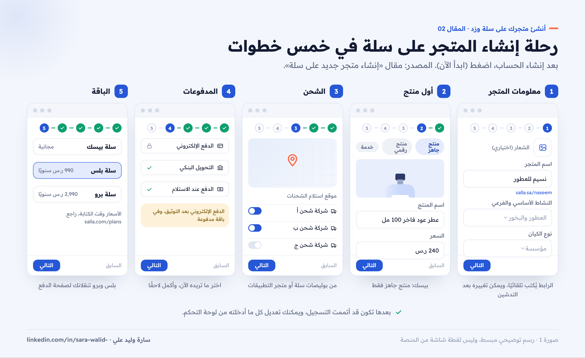
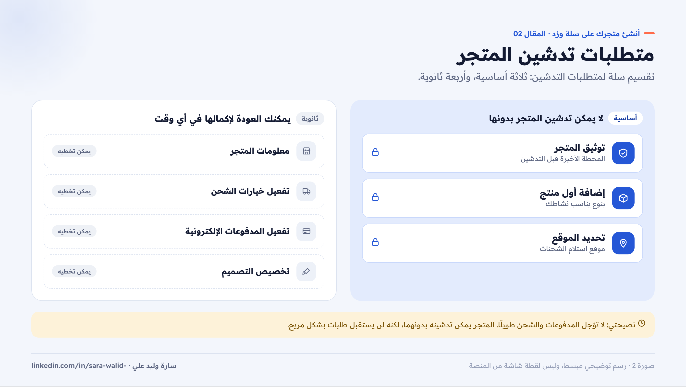
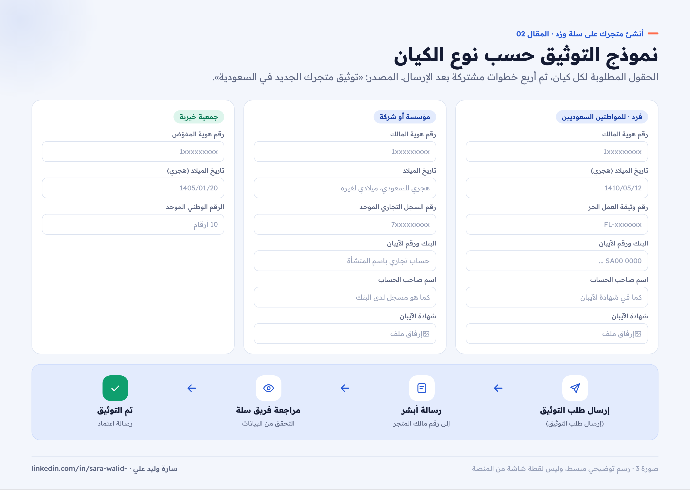
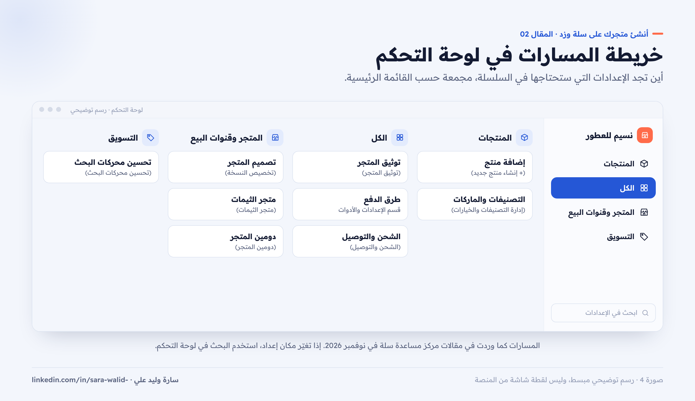

# 02 — إنشاء متجرك على سلة وتوثيقه

**سلسلة: أنشئ متجرك على سلة وزد خطوة بخطوة · المقال 02**
بقلم: سارة وليد علي · مصممة منتجات رقمية UX/UI · نوفمبر 2026

**[اقرأ المقال على موقع السلسلة ←](https://sarawalidali200-tech.github.io/salla-zid-store-setup-guide/02-create-salla-store.html)**

> **قبل القراءة:** الخطوات مأخوذة من مركز مساعدة سلة كما كان في نوفمبر 2026. أسماء الأزرار مكتوبة بين قوسين كما تظهر في لوحة التحكم، مثل (ابدأ الآن).

---

## ما ستنجزه في هذا المقال

في نهاية هذا المقال سيكون لديك متجر على سلة باسمه وشعاره ورابطه، وأول منتج، وموقع لاستلام الشحنات، وطلب توثيق مُرسل. هذه هي المتطلبات الأساسية لتدشين المتجر.

## رحلة إنشاء المتجر: خمس خطوات

بعد إنشاء حساب جديد على سلة، اضغط (ابدأ الآن) لإنشاء متجر جديد. تأخذك سلة في رحلة من خمس خطوات ([إنشاء متجر جديد على سلة](https://help.salla.sa/article/create-new-store-on-salla/uqwvq1ztbcbj7ldi0xwbee7h)):

*صورة 1: رحلة إنشاء المتجر في خمس خطوات، وما تدخله في كل خطوة.*

### أولًا: معلومات المتجر

1. **الشعار (اختياري):** يظهر للعملاء، ويمكنك تغييره بعد التدشين.
2. **اسم المتجر:** الاسم الذي سيظهر للعملاء. لاحظ أن رابط متجرك يُكتب تلقائيًا أسفل الخانة، ويمكنك تغييره لاحقًا في أي وقت.
3. **النشاط التجاري:** حدد النشاط الأساسي والفرعي.
4. **نوع الكيان:** اختر نوع الكيان، ثم اضغط (التالي).

### ثانيًا: أول منتج

أضف منتجك الأول بالنوع الذي يناسب نشاطك. مثلًا: إذا كنت تقدم خدمات رقمية فأضف منتجًا رقميًا. أدخل البيانات المطلوبة، ثم اضغط (التالي). تفاصيل إضافة المنتجات في المقال 03.

**انتبه:** باقة سلة بيسك المجانية تتيح نوع «منتج جاهز» فقط. الأنواع الأخرى، مثل المنتجات الرقمية والبطاقات الرقمية ومنتج الأكل والمنتج حسب الطلب ومجموعة المنتجات ومنتج الحجوزات، متاحة في سلة بلس وسلة برو.

### ثالثًا: خيارات الشحن

1. حدد **موقع استلام الشحنات** على الخريطة الظاهرة في الصفحة.
2. فعّل شركات الشحن التي تناسبك من قائمة **بوليصات سلة**. ويمكنك الوصول إلى شركات شحن أخرى من متجر التطبيقات.

### رابعًا: المدفوعات الإلكترونية

اختر وفعّل وسائل الدفع بينك وبين عملائك. **ملاحظة مهمة:** بوابات الدفع الإلكتروني تعمل بعد إتمام توثيق المتجر، وتحتاج باقة مدفوعة. تفاصيل الدفع في المقال 04.

### خامسًا: الباقة

اختر الباقة التي تبدأ بها، ثم اضغط (التالي). إذا اخترت سلة بلس أو سلة برو، ستنتقل إلى صفحة الدفع لإتمام الاشتراك.

بعد هذه الخطوة تكون قد أتممت التسجيل، ويمكنك تعديل كل ما أدخلته من لوحة التحكم.

## متطلبات التدشين: ما لا يمكن تخطيه

تقسّم سلة متطلبات تدشين المتجر إلى نوعين ([المصدر](https://help.salla.sa/article/create-new-store-on-salla/uqwvq1ztbcbj7ldi0xwbee7h)):

| النوع | المتطلبات | هل يمكن تخطيها؟ |
| --- | --- | --- |
| أساسية | توثيق المتجر، إضافة أول منتج، تحديد الموقع | لا |
| ثانوية | معلومات المتجر، تفعيل خيارات الشحن، تفعيل المدفوعات الإلكترونية، تخصيص التصميم | نعم، ويمكنك العودة لإكمالها في أي وقت |

*صورة 2: ثلاثة متطلبات أساسية لا يمكن تخطيها، وأربعة يمكن إكمالها لاحقًا.*

## خطوات إعداد المتجر بعد التسجيل

دليل التدشين في سلة يرتب إعداد المتجر في سبع خطوات ([تدشين متجرك على سلة](https://help.salla.sa/article/launch-your-store-on-salla/zgflevdt56pvfugbbnnkzr06)):

1. **هوية المتجر:** الاسم، والوصف، والشعار، واللون، ثم (حفظ).
2. **قنوات خدمة العملاء:** يُستخدم رقم الجوال المسجل في حسابك افتراضيًا ويظهر أسفل المتجر. لاستخدام رقم آخر، ألغِ تحديد خيار (استخدام نفس الرقم المسجّل في حسابك)، ثم أدخل الرقم وأكمل التحقق.
3. **دومين المتجر:** حدد النطاق الذي تريده، ثم (حفظ). اختر اسمًا قصيرًا وسهل التذكر.
4. **أول منتج:** اختر نوع المنتج المناسب وأدخل بياناته.
5. **موقع استلام الشحنات:** حدده بدقة على الخريطة.
6. **تصميم المتجر:** ستنتقل إلى صفحة تصميم المتجر. التفاصيل في المقال 05.
7. **توثيق المتجر:** المحطة الأخيرة قبل التدشين.

## توثيق المتجر خطوة بخطوة

توثيق المتجر في سلة هو التحقق من بيانات متجرك واعتمادها داخل المنصة، وهو إجراء مستقل عن توثيق منصة الأعمال أو أي توثيق خارجي. يفيدك التوثيق في تفعيل بوابات الدفع وخدمات الشحن، وفي رفع ثقة العملاء بمتجرك ([توثيق متجرك الجديد في السعودية](https://help.salla.sa/article/verifying-your-new-store-in-saudi-arabia/ig4b4l5hc542j4bcd2tp82bz)).

### الوصول إلى صفحة التوثيق

اضغط (ابدأ توثيق متجرك)، أو ادخل إلى صفحة (توثيق المتجر) من تبويب (الكل) في القائمة الرئيسية.

### البيانات المطلوبة حسب الكيان

*صورة 3: حقول نموذج التوثيق لكل نوع كيان، والخطوة المشتركة بعد الإرسال.*

| البيان | فرد | مؤسسة | شركة |
| --- | --- | --- | --- |
| رقم هوية المالك | ✓ | ✓ | ✓ |
| تاريخ الميلاد | بالهجري | هجري للسعوديين، ميلادي لغيرهم | هجري للسعوديين، ميلادي لغيرهم |
| الوثيقة | رقم وثيقة العمل الحر | رقم السجل التجاري الموحد | رقم السجل التجاري الموحد |
| البنك والآيبان واسم صاحب الحساب | ✓ | ✓ حساب تجاري باسم المؤسسة | ✓ حساب تجاري باسم الشركة |
| شهادة الآيبان | ✓ | ✓ | ✓ |

وللجمعيات الخيرية: رقم هوية المفوّض عن الجمعية، وتاريخ ميلاده بالهجري، والرقم الوطني الموحد للجمعية المكوّن من 10 أرقام. وتحصل الجمعيات على باقة سلة برو مجانًا مدى الحياة بعد إتمام التوثيق.

### الإرسال والتحقق

1. اضغط (إرسال طلب التوثيق).
2. ستصل رسالة نصية من **أبشر** إلى رقم مالك المتجر المسجل لتأكيد الهوية.
3. يراجع فريق سلة الطلب، وعند اكتمال البيانات وصحتها تصلك رسالة بأن متجرك تم توثيقه.

### نصائح لقبول الطلب من أول مرة

- راجع كل رقم مرتين قبل الإرسال، خصوصًا رقم الآيبان والسجل.
- اكتب اسم صاحب الحساب كما هو في شهادة الآيبان، وليس كما هو على البطاقة.
- لا ترفع وثائق باسم شخص آخر غير مالك المتجر.

بعد اعتماد التوثيق، انتقل إلى تفعيل بوابات الدفع وخدمات الشحن، وهذا موضوع المقال 04.

## أين تجد كل شيء في لوحة التحكم؟

سلة حدّثت التنقل في لوحة التحكم، وأغلب الإعدادات أصبحت تحت قائمة (الكل) أو (المتجر وقنوات البيع). هذه خريطة المسارات التي ستحتاجها في السلسلة، كما وردت في مقالات مركز المساعدة:

| ماذا تريد | المسار |
| --- | --- |
| توثيق المتجر | تبويب (الكل) ← (توثيق المتجر) |
| إضافة منتج | (المنتجات) ← (+ إنشاء منتج جديد) |
| التصنيفات والماركات | (المنتجات) ← (التصنيفات والخيارات) |
| طرق الدفع | (الكل) ← قسم الإعدادات والأدوات ← (طرق الدفع) |
| الشحن والتوصيل | (الكل) ← (الشحن والتوصيل) |
| تصميم المتجر | (المتجر وقنوات البيع) ← (تصميم المتجر) |
| متجر الثيمات | (المتجر وقنوات البيع) ← (متجر الثيمات) |
| دومين المتجر | (المتجر وقنوات البيع) ← (دومين المتجر) |
| تحسين محركات البحث | تبويب التسويق ← (تحسين محركات البحث) |

*صورة 4: خريطة مبسطة لمسارات الإعدادات التي تستخدمها في السلسلة.*

**نصيحة:** إذا لم تجد إعدادًا، استخدم البحث في لوحة التحكم، أو ابحث عن اسمه في [مركز مساعدة سلة](https://help.salla.sa/).

## قائمة المراجعة

- [ ] أنشأت الحساب وأكملت رحلة الإنشاء الخمس.
- [ ] أضفت أول منتج، وحددت موقع استلام الشحنات.
- [ ] أدخلت هوية المتجر: الاسم والوصف والشعار واللون.
- [ ] تأكدت من رقم خدمة العملاء.
- [ ] اخترت دومين المتجر.
- [ ] أرسلت طلب التوثيق، وأكدت رسالة أبشر.

## المصادر

- [سلة: إنشاء متجر جديد على سلة](https://help.salla.sa/article/create-new-store-on-salla/uqwvq1ztbcbj7ldi0xwbee7h)
- [سلة: تدشين متجرك على سلة](https://help.salla.sa/article/launch-your-store-on-salla/zgflevdt56pvfugbbnnkzr06)
- [سلة: توثيق متجرك الجديد في السعودية](https://help.salla.sa/article/verifying-your-new-store-in-saudi-arabia/ig4b4l5hc542j4bcd2tp82bz)

---

**المقال السابق:** [01 — قبل أن تبدأ](../01-before-you-start/README.md) · **المقال التالي:** [03 — المنتجات والتصنيفات](../03-products/README.md)

