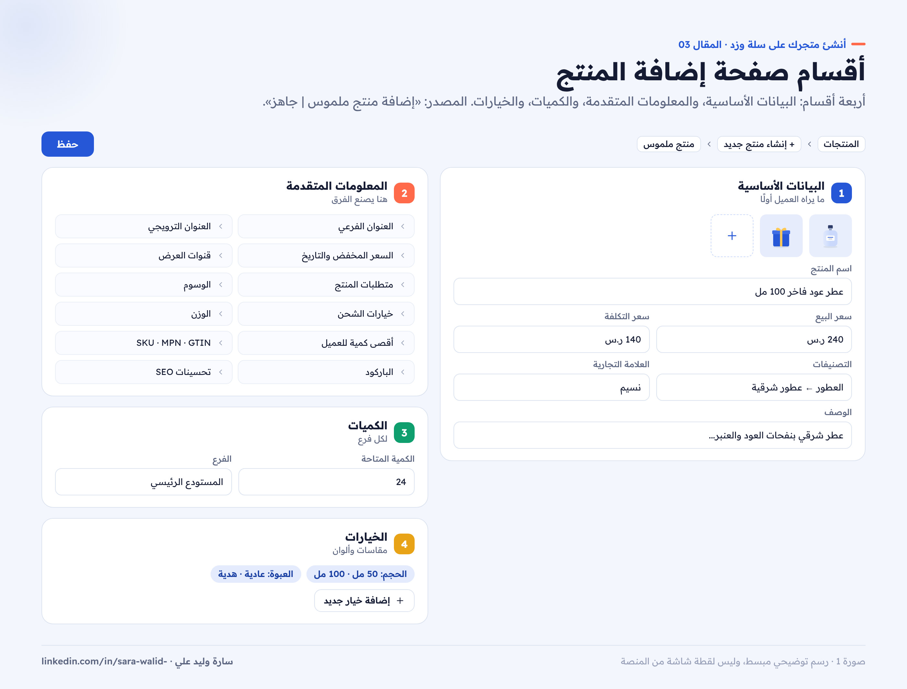
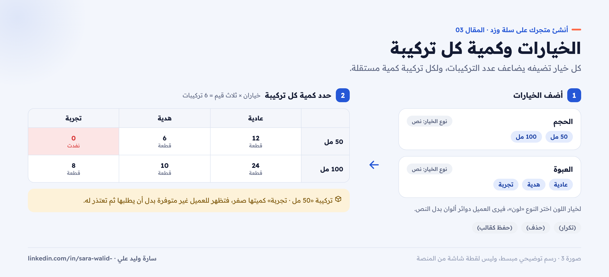
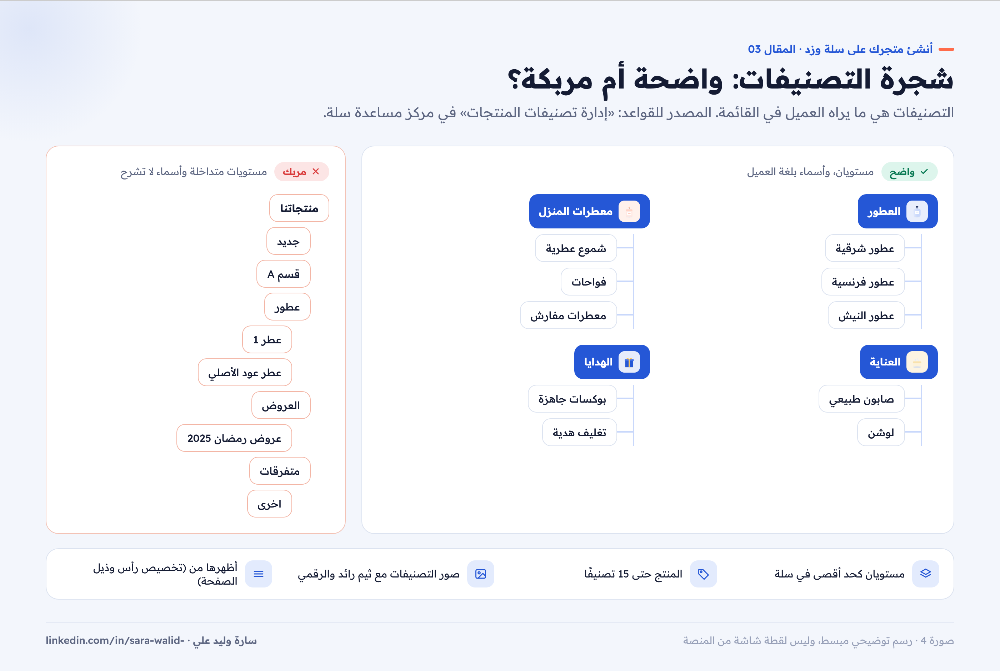

# 03 — المنتجات والتصنيفات على سلة

**سلسلة: أنشئ متجرك على سلة وزد خطوة بخطوة · المقال 03**
بقلم: سارة وليد علي · مصممة منتجات رقمية UX/UI · نوفمبر 2026

**[اقرأ المقال على موقع السلسلة ←](https://sarawalidali200-tech.github.io/salla-zid-store-setup-guide/03-products.html)**

> **قبل القراءة:** الخطوات من مركز مساعدة سلة كما كان في نوفمبر 2026. هذا المقال يشرح نوع «المنتج الجاهز» لأنه المتاح في كل الباقات، وأغلب حقوله مشتركة مع الأنواع الأخرى.

---

## المنتج هو أهم صفحة في متجرك

العميل لا يرى لوحة التحكم، بل يرى نتيجتها: صورة، واسم، وسعر، وزر شراء. كل حقل تملؤه في صفحة إضافة المنتج يظهر في مكان محدد أمام العميل. لذلك سأشرح الحقول، وأوضح أين يظهر كل حقل في المتجر، حتى تعرف أيها يستحق وقتك أكثر.

## أنواع المنتجات في سلة

| النوع | مثال | الباقة |
| --- | --- | --- |
| منتج جاهز (ملموس) | ملابس، عطور، أجهزة | كل الباقات |
| منتج رقمي | كتاب إلكتروني، دورة، ملفات | سلة بلس وسلة برو |
| بطاقة رقمية | بطاقات شحن واشتراكات | سلة بلس وسلة برو |
| منتج أكل | مطاعم ومخابز | سلة بلس وسلة برو |
| منتج حسب الطلب | كيك مخصص، طباعة على منتج | سلة بلس وسلة برو |
| مجموعة منتجات | باقة من عدة منتجات بسعر واحد | سلة بلس وسلة برو |
| منتج حجوزات | مواعيد وخدمات | سلة بلس وسلة برو |

المصدر: [إنشاء متجر جديد على سلة](https://help.salla.sa/article/create-new-store-on-salla/uqwvq1ztbcbj7ldi0xwbee7h).

## إضافة منتج جاهز خطوة بخطوة

1. من القائمة الرئيسية، اضغط (المنتجات).
2. من قائمة (+ إنشاء منتج جديد)، اختر (منتج ملموس).
3. أدخل البيانات الأساسية، ثم اضغط (حفظ).

المصدر: [إضافة منتج ملموس | جاهز](https://help.salla.sa/article/add-a-physical-product-ready-product-1/j26383gile80wtexu77744u9).

*صورة 1: صفحة إضافة المنتج مقسمة إلى أربعة أقسام: الأساسي، والمتقدم، والكميات، والخيارات.*

### القسم الأول: البيانات الأساسية

| الحقل | ماذا تكتب | نصيحة |
| --- | --- | --- |
| الصور | صورة أو أكثر للمنتج | الصورة الأولى للمنتج وحده على خلفية موحدة |
| اسم المنتج | الاسم الذي يظهر للعميل | النوع + أهم صفة + الحجم، بدون رموز أو كلمات مكررة |
| السعر | سعر البيع وسعر التكلفة | سعر التكلفة لا يظهر للعميل، ويساعدك في متابعة صافي الربح |
| التصنيفات | التصنيف الذي ينتمي له المنتج | يمكن ربط المنتج بحتى 15 تصنيفًا |
| تصنيفات جوجل | تصنيف المنتج وفق تصنيفات جوجل | لا يظهر للعميل، ويُستخدم في فيد المنتجات الإعلاني، ومتاح للباقات المدفوعة |
| العلامة التجارية | ماركة المنتج | تفيد في فلترة المنتجات وصفحات الماركات |
| الوصف | وصف تفصيلي بنص وصور وفيديو | ابدأ بالفائدة، ثم المواصفات في نقاط |

### القسم الثاني: المعلومات المتقدمة

هذا القسم هو الذي يصنع الفرق بين متجر عادي ومتجر احترافي:

- **العنوان الفرعي:** يظهر تحت اسم المنتج، مثل «تحميص أسبوعي».
- **العنوان الترويجي:** يوضع على صورة المنتج للفت الانتباه، مثل «الأكثر مبيعًا».
- **السعر المخفض:** مع تاريخ بداية ونهاية التخفيض، فيظهر للعميل السعر قبل وبعد الخصم.
- **قنوات عرض المنتج:** إظهار المنتج أو إخفاؤه في الموقع أو التطبيق أو محلي، واختيار الفروع.
- **متطلبات المنتج:** السماح للعميل بإرفاق ملف (مثل صورة لطباعتها على كيك)، أو كتابة ملاحظة، وتحديد هل المنتج خاضع للضريبة.
- **الوسوم:** تظهر في بطاقة المنتج، وعند الضغط عليها يرى العميل كل المنتجات التي تحمل الوسم نفسه.
- **خيارات الشحن:** «يتطلب توصيل» أو «لا يتطلب توصيل». الخيار الثاني لا يعني أنك لن توصل المنتج، بل يعني أن العميل سينتقل للدفع مباشرة دون اختيار شركة شحن.
- **الوزن:** مطلوب لدى شركات الشحن التي تحسب التكلفة بالوزن.
- **أقصى كمية لكل عميل:** اختياري، ومفيد للمنتجات المحدودة.
- **SKU وMPN وGTIN:** رموز تعريف المنتج، ومهمة للمستودعات ومحركات البحث.
- **الباركود:** لإدارة المخزون والبيع في الفروع عبر سلة بوينت.
- **تحسينات SEO:** عنوان صفحة المنتج، ورابط مخصص، ووصف للصفحة.

*صورة 2: كل حقل من لوحة التحكم، ومكان ظهوره أمام العميل في بطاقة المنتج وصفحته.*

### القسم الثالث: الكميات

أضف الكمية المتاحة للمنتج، ويمكنك تحديدها لكل فرع. إذا تركت الكمية بدون متابعة، قد تبيع منتجًا غير موجود.

### القسم الرابع: الخيارات

الخيارات هي المقاسات والألوان وأي اختيار يحدده العميل قبل الشراء.

1. من تبويب الخيارات، اضغط (إضافة خيار جديد).
2. أدخل اسم الخيار، مثل «الحجم» أو «لون القماش».
3. اختر نوع الخيار: نص أو لون.
4. أدخل قيم الخيار، مثل «صغير، وسط، كبير»، ثم اضغط (تأكيد).
5. لتحديد كمية كل خيار، اضغط علامة (+) بجانب قسم الكميات ثم (تعديل).

ويمكنك (تكرار) الخيار، أو (حذف) الخيار، أو (حفظ كقالب) لاستخدامه مع منتجات أخرى. والقوالب يمكن ترتيبها من صفحة (التصنيفات والخيارات) ثم (الخيارات).

*صورة 3: خياران (الحجم واللون) يصنعان ست تركيبات، ولكل تركيبة كمية خاصة.*

**نصيحة تجربة مستخدم:** لا تضف خيارًا بقيمة واحدة. وإذا كان للخيار أثر على السعر أو الصورة، وضّح ذلك في الوصف، لأن العميل يتوقع أن تتغير الصورة مع اللون.

### الحقول المخصصة

لإضافة معلومات لا تناسب الوصف، مثل نوع العبوة وأبعادها، اضغط (إضافة قسم جديد) في قسم الحقول المخصصة، واختر نوع الحقل، وحدد هل يظهر للعميل.

## التصنيفات: كيف ينظم العميل رحلته

التصنيفات هي ما يراه العميل في القائمة الرئيسية. تنظيمها الجيد يختصر الطريق إلى المنتج ([إدارة تصنيفات المنتجات](https://help.salla.sa/article/%D8%A5%D8%AF%D8%A7%D8%B1%D8%A9-%D8%AA%D8%B5%D9%86%D9%8A%D9%81%D8%A7%D8%AA-%D8%A7%D9%84%D9%85%D9%86%D8%AA%D8%AC%D8%A7%D8%AA/ghxuwuy7ivin8wyath9w22ch)).

### قواعد سلة للتصنيفات

- مستويان كحد أقصى: تصنيف رئيسي وتصنيف فرعي.
- المنتج الواحد يمكن ربطه بحتى 15 تصنيفًا.
- يمكن إضافة صور للتصنيفات، وتظهر في المتجر مع ثيم رائد أو الثيم الرقمي.
- يمكن ترتيب المنتجات داخل كل تصنيف بشكل مستقل.

### إنشاء التصنيفات

1. من القائمة الرئيسية، اضغط (المنتجات)، ثم (إدارة التصنيفات والخيارات).
2. من صفحة (التصنيفات والخيارات)، اضغط (التصنيفات).
3. اضغط (+ إضافة تصنيف) وأدخل معلوماته.
4. لإضافة تصنيف فرعي، اضغط (...) بجانب التصنيف الرئيسي، ثم (إضافة تصنيف فرعي).
5. لترتيب المنتجات داخل التصنيف، افتح التصنيف واضغط (إضافة وترتيب المنتجات)، ثم اسحب المنتجات.

### إظهار التصنيفات في قائمة المتجر

إنشاء التصنيف لا يضيفه تلقائيًا للقائمة. لإظهاره: (المتجر وقنوات البيع) ← (تصميم المتجر) ← (تخصيص) في بطاقة الثيم ← تبويب (تخصيص رأس وذيل الصفحة) ← حدد قائمة التصنيفات.

*صورة 4: شجرة تصنيفات واضحة بمستويين، مقابل شجرة مربكة بتصنيفات متداخلة.*

### نصائح لتصنيفات واضحة

- **سمِّ التصنيف بلغة العميل:** «عطور رجالية» أوضح من «قسم R».
- **من 4 إلى 8 تصنيفات رئيسية** غالبًا كافية لمتجر جديد.
- **لا تصنع تصنيفًا لمنتج واحد.** انتظر حتى يصبح لديك عدد كافٍ.
- **العروض ليست تصنيفًا دائمًا.** استخدم الوسوم أو عنصر «منتجات من وسم» في الصفحة الرئيسية للحملات الموسمية.

## قائمة المراجعة

- [ ] لكل منتج صور متناسقة، والصورة الأولى للمنتج وحده.
- [ ] الاسم واضح، والسعر وسعر التكلفة مُدخلان.
- [ ] الوصف يبدأ بالفائدة، والمواصفات في نقاط.
- [ ] الوزن والكمية مُدخلان لكل منتج قابل للشحن.
- [ ] الخيارات مضافة، ولكل تركيبة كمية.
- [ ] تحسينات SEO مكتوبة لأهم المنتجات.
- [ ] التصنيفات بمستويين كحد أقصى، وظاهرة في قائمة المتجر.

## المصادر

- [سلة: إضافة منتج ملموس | جاهز](https://help.salla.sa/article/add-a-physical-product-ready-product-1/j26383gile80wtexu77744u9)
- [سلة: إدارة تصنيفات المنتجات](https://help.salla.sa/article/%D8%A5%D8%AF%D8%A7%D8%B1%D8%A9-%D8%AA%D8%B5%D9%86%D9%8A%D9%81%D8%A7%D8%AA-%D8%A7%D9%84%D9%85%D9%86%D8%AA%D8%AC%D8%A7%D8%AA/ghxuwuy7ivin8wyath9w22ch)
- [سلة: إنشاء متجر جديد على سلة](https://help.salla.sa/article/create-new-store-on-salla/uqwvq1ztbcbj7ldi0xwbee7h)

---

**المقال السابق:** [02 — إنشاء متجرك على سلة وتوثيقه](../02-create-salla-store/README.md) · **المقال التالي:** [04 — الدفع والشحن](../04-payments-shipping/README.md)

