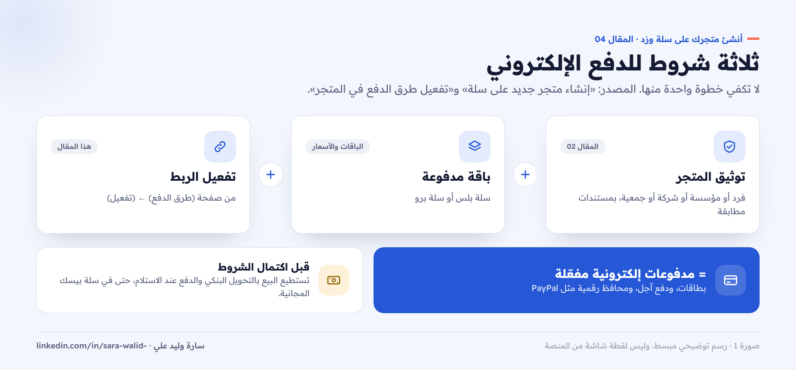
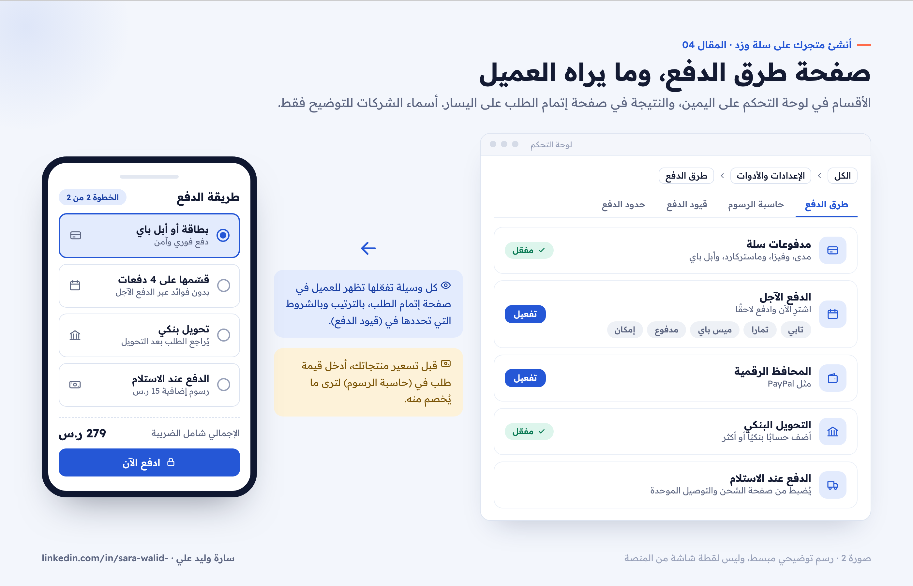
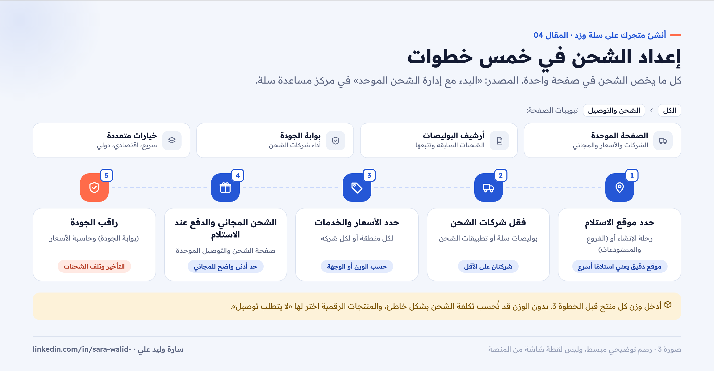
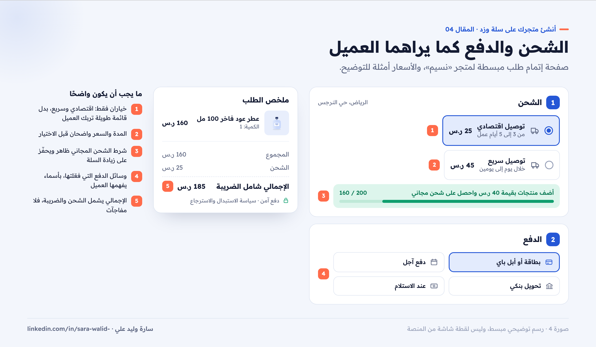

# 04 — الدفع والشحن على سلة

**سلسلة: أنشئ متجرك على سلة وزد خطوة بخطوة · المقال 04**
بقلم: سارة وليد علي · مصممة منتجات رقمية UX/UI · نوفمبر 2026

**[اقرأ المقال على موقع السلسلة ←](https://sarawalidali.github.io/salla-zid-store-setup-guide/04-payments-shipping.html)**

> **قبل القراءة:** الخطوات من مركز مساعدة سلة كما كان في نوفمبر 2026. الرسوم والحدود تتغير، فاستخدم حاسبة الرسوم داخل لوحة التحكم قبل تحديد أسعارك.

---

## لحظة الحقيقة في المتجر

العميل الذي وصل إلى صفحة الدفع قرر أن يشتري. أي مفاجأة هنا، مثل طريقة دفع غير متوفرة أو تكلفة شحن لم يتوقعها، قد تجعله يترك السلة. لذلك إعداد الدفع والشحن ليس خطوة تقنية فقط، بل جزء من تجربة الشراء.

## أولًا: الدفع

### ثلاثة شروط للدفع الإلكتروني

لتستقبل مدفوعات إلكترونية في سلة، تحتاج ثلاثة أشياء معًا ([إنشاء متجر جديد على سلة](https://help.salla.sa/article/create-new-store-on-salla/uqwvq1ztbcbj7ldi0xwbee7h)):

1. **توثيق المتجر:** شرط أساسي لتفعيل بوابات الدفع الإلكتروني. شرحناه في المقال 02.
2. **باقة مدفوعة:** سلة بلس أو سلة برو.
3. **تفعيل الربط** مع وسائل الدفع من صفحة طرق الدفع.

*صورة 1: الدفع الإلكتروني يعمل عندما تكتمل الشروط الثلاثة معًا.*

### ماذا تتيح كل باقة؟

| | سلة بيسك (مجانية) | سلة بلس وسلة برو |
| --- | --- | --- |
| التحويل البنكي | ✓ | ✓ |
| الدفع عند الاستلام | ✓ عبر شركة الشحن أو مندوبك | ✓ |
| الدفع الإلكتروني (مدفوعات سلة) | ✗ | ✓ بعد التوثيق |
| الدفع الآجل (اشترِ الآن وادفع لاحقًا) | ✗ | ✓ |
| المحافظ الرقمية مثل PayPal | ✗ | ✓ |

المصدر: [تفعيل طرق الدفع في المتجر](https://help.salla.sa/article/enable-payment-methods-in-your-store-saudi-arabia/dcrwxldslve7spa8eqdgii8g).

### الوصول إلى صفحة طرق الدفع

من القائمة الرئيسية، من قائمة (الكل)، من قسم الإعدادات والأدوات، اضغط (طرق الدفع). تحتوي الصفحة على هذه الأقسام:

- **مدفوعات سلة:** الأكثر أمانًا والأسهل في التفعيل. من تبويب (طرق الدفع) اضغط (تفعيل) ([تفعيل المدفوعات الإلكترونية](https://help.salla.sa/article/%D8%AA%D9%81%D8%B9%D9%8A%D9%84-%D8%A7%D9%84%D9%85%D8%AF%D9%81%D9%88%D8%B9%D8%A7%D8%AA-%D8%A7%D9%84%D8%A5%D9%84%D9%83%D8%AA%D8%B1%D9%88%D9%86%D9%8A%D8%A9/ppros5gh7uqhilhqddqnjgbd)).
- **الدفع الآجل:** مثل تابي، وتمارا، وميس باي، ومدفوع، وإمكان. لكل واحدة مقال تفعيل مستقل في مركز المساعدة.
- **المحافظ الرقمية:** مثل PayPal.
- **التحويل البنكي:** ويمكنك إضافة أكثر من حساب بنكي.

ولتفعيل أي وسيلة: اخترها من صفحة (طرق الدفع)، واضغط (تفعيل)، ثم أكمل بياناتها.

*صورة 2: أقسام صفحة طرق الدفع، وما يظهر للعميل في صفحة إتمام الطلب.*

### أدوات مهمة في صفحة الدفع

- **حاسبة الرسوم:** أدخل قيمة الطلب وطريقة الدفع لترى الرسوم المترتبة عليه. استخدمها قبل تسعير منتجاتك.
- **قيود الدفع:** شروط تتحكم في ظهور وسائل الدفع، مثل إخفاء الدفع عند الاستلام للعملاء الجدد، أو إظهار وسائل محددة لتصنيفات معينة.
- **حدود الدفع الإلكتروني:** الحدود المسموحة للعمليات حسب الدولة ونوع المنتج.
- **إعدادات صفحة إتمام الطلب:** من تبويب (صفحة إتمام الطلب) في مركز الإعدادات الموحد.

### أين تذهب أموالك؟

عندما يدفع العميل إلكترونيًا، تذهب الأموال أولًا إلى **رصيد المدفوعات الإلكترونية**، ثم يمكنك تحويلها إلى **رصيد المتجر** لاستخدامها أو سحبها. والمحفظة في لوحة التحكم تجمع: رصيد المتجر، ورصيد المدفوعات الإلكترونية، ورصيد الدفع عند الاستلام.

## ثانيًا: الشحن

### صفحة الشحن الموحد

سلة تجمع كل ما يخص الشحن في مكان واحد: شركات التوصيل، والأسعار، والمناطق، والشحن المجاني، والدفع عند الاستلام ([البدء مع إدارة الشحن الموحد](https://help.salla.sa/article/shipping-management-getting-started/avovvtw08svsd6wso6g5uras)).

المسار: من لوحة التحكم، من قائمة (الكل)، اضغط (الشحن والتوصيل). ستجد تبويبات:

- **صفحة الشحن والتوصيل الموحدة:** إدارة شركات الشحن، وأسعار التوصيل، والدفع عند الاستلام، والشحن المجاني.
- **أرشيف البوليصات:** كل البوليصات والشحنات السابقة وتتبعها.
- **بوابة الجودة:** متابعة أداء شركات الشحن، مثل التأخير أو تلف الشحنات.
- **خيارات شحن متعددة:** سريع أو اقتصادي أو دولي، وطريقة عرض الشركات في صفحة الدفع.

### إعداد الشحن في خمس خطوات

*صورة 3: خمس خطوات لإعداد الشحن، من تحديد الموقع حتى متابعة الجودة.*

1. **حدد موقع استلام الشحنات:** من رحلة الإنشاء، أو من الفروع والمستودعات. موقع دقيق يعني استلامًا أسرع.
2. **فعّل شركات الشحن:** من بوليصات سلة، أو من تطبيقات شركات الشحن في متجر التطبيقات.
3. **حدد الأسعار والخدمات:** لكل منطقة أو لكل شركة، حسب الوزن أو الوجهة أو نوع الخدمة.
4. **اضبط الشحن المجاني والدفع عند الاستلام:** من صفحة الشحن والتوصيل الموحدة.
5. **راقب الجودة:** من بوابة الجودة، واستخدم حاسبة أسعار الشحن لتقدير التكلفة.

### نصائح تجعل الشحن لا يوقف الشراء

- **أدخل وزن كل منتج:** بدونه قد تُحسب تكلفة الشحن بشكل خاطئ.
- **اعرض خيارين أو ثلاثة فقط:** خيار اقتصادي وخيار سريع غالبًا يكفيان. كثرة الخيارات تربك العميل.
- **الشحن المجاني بحد أدنى واضح:** مثل «شحن مجاني للطلبات فوق 200 ر.س»، واكتبه في شريط الإعلانات أعلى المتجر.
- **المنتجات الرقمية لا تحتاج شحنًا:** اختر «لا يتطلب توصيل» في المنتج، فينتقل العميل للدفع مباشرة.

## كيف يرى العميل كل هذا؟

كل ما أعددته يظهر في خطوتين داخل صفحة إتمام الطلب: اختيار الشحن، ثم اختيار طريقة الدفع. افتح متجرك كعميل وجرّب طلبًا كاملًا بعد كل تغيير، وهذا ما سنفعله بالتفصيل في المقال 06.

*صورة 4: خطوتا الشحن والدفع في صفحة إتمام الطلب، وما يجب أن يكون واضحًا فيهما.*

## قائمة المراجعة

- [ ] المتجر موثق، والباقة تدعم الدفع الإلكتروني إن كنت تحتاجه.
- [ ] مدفوعات سلة مفعلة، أو على الأقل التحويل البنكي والدفع عند الاستلام.
- [ ] جربت حاسبة الرسوم قبل تسعير المنتجات.
- [ ] موقع استلام الشحنات دقيق.
- [ ] شركتا شحن على الأقل مفعلتان بأسعار واضحة.
- [ ] شرط الشحن المجاني محدد ومكتوب في المتجر.
- [ ] جربت طلبًا كاملًا ورأيت خيارات الشحن والدفع كما يراها العميل.

## المصادر

- [سلة: تفعيل طرق الدفع في المتجر](https://help.salla.sa/article/enable-payment-methods-in-your-store-saudi-arabia/dcrwxldslve7spa8eqdgii8g)
- [سلة: تفعيل المدفوعات الإلكترونية](https://help.salla.sa/article/%D8%AA%D9%81%D8%B9%D9%8A%D9%84-%D8%A7%D9%84%D9%85%D8%AF%D9%81%D9%88%D8%B9%D8%A7%D8%AA-%D8%A7%D9%84%D8%A5%D9%84%D9%83%D8%AA%D8%B1%D9%88%D9%86%D9%8A%D8%A9/ppros5gh7uqhilhqddqnjgbd)
- [سلة: البدء مع إدارة الشحن الموحد](https://help.salla.sa/article/shipping-management-getting-started/avovvtw08svsd6wso6g5uras)
- [سلة: إنشاء متجر جديد على سلة](https://help.salla.sa/article/create-new-store-on-salla/uqwvq1ztbcbj7ldi0xwbee7h)

---

**المقال السابق:** [03 — المنتجات والتصنيفات](../03-products/README.md) · **المقال التالي:** [05 — تخصيص تصميم متجرك](../05-design-customization/README.md)

