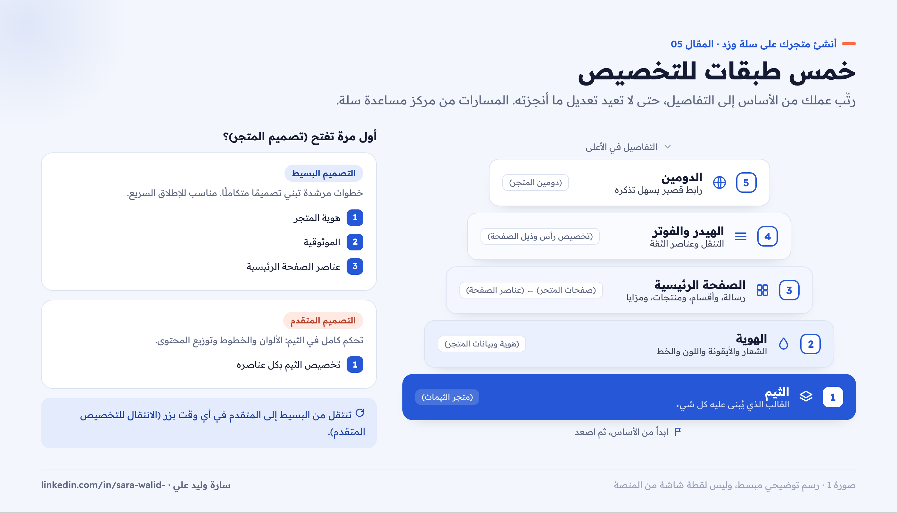
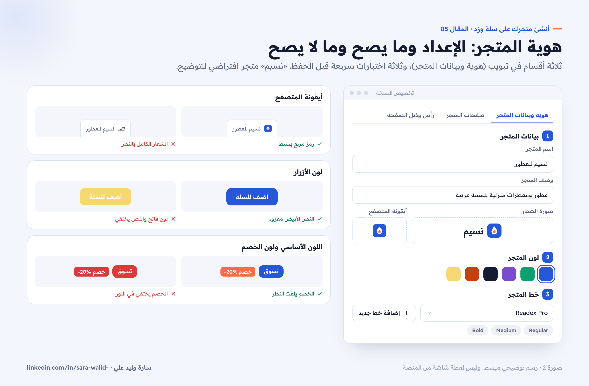
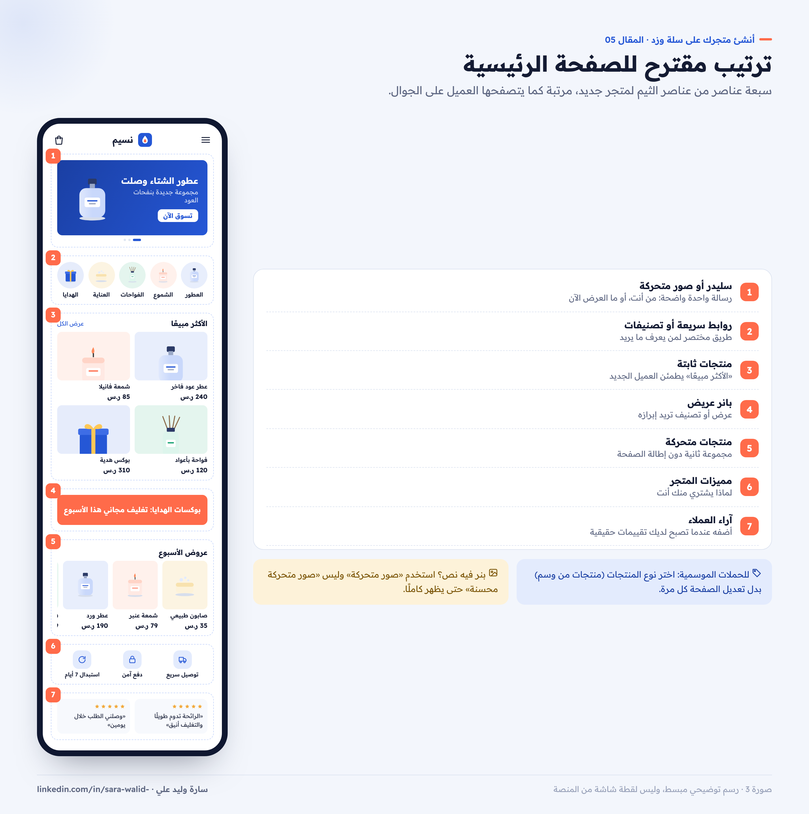
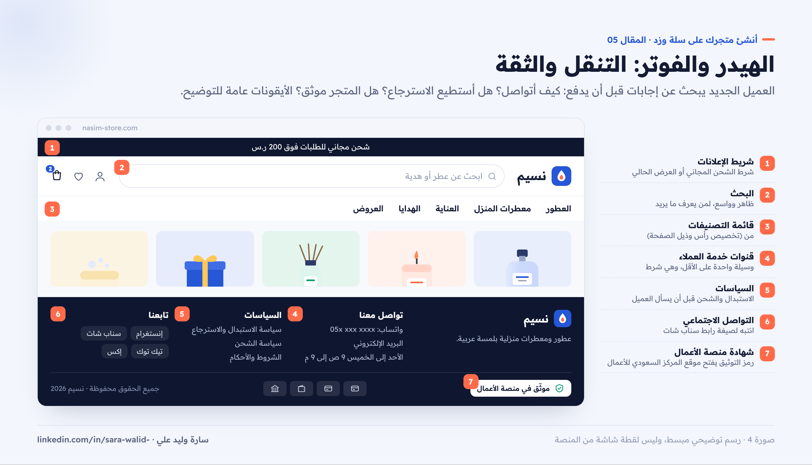
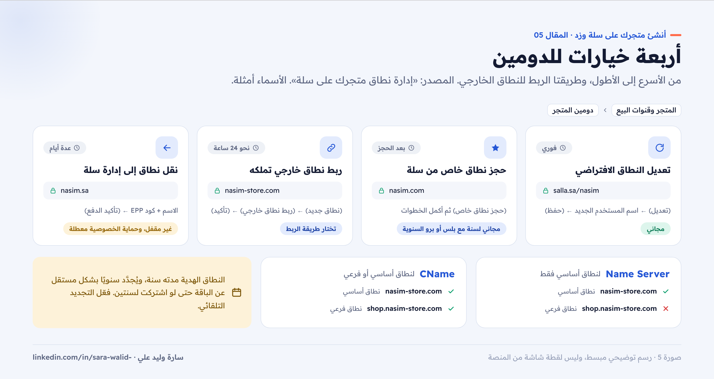

# 05 — تخصيص تصميم متجرك على سلة

**سلسلة: أنشئ متجرك على سلة وزد خطوة بخطوة · المقال 05**
بقلم: سارة وليد علي · مصممة منتجات رقمية UX/UI · نوفمبر 2026

**[اقرأ المقال على موقع السلسلة ←](https://sarawalidali.github.io/salla-zid-store-setup-guide/05-design-customization.html)**

> **قبل القراءة:** الخطوات من مركز مساعدة سلة كما كان في نوفمبر 2026. عناصر الصفحة الرئيسية المذكورة هنا من ثيم «رائد» كما يشرحها مركز المساعدة، وقد تختلف من ثيم لآخر.

---

## التصميم ليس ألوانًا فقط

هذا الجزء الذي أحبه أكثر كمصممة. التخصيص الجيد لا يعني أن تضيف كل العناصر المتاحة، بل أن تختار ما يساعد العميل على أن يفهم متجرك ويثق فيه ويصل للمنتج بسرعة. في هذا المقال سنمر على التخصيص بالترتيب الذي أنصح به: الثيم، ثم الهوية، ثم الصفحة الرئيسية، ثم الهيدر والفوتر، ثم الدومين.

*صورة 1: خمس طبقات للتخصيص، من الأساس إلى التفاصيل.*

## 1. اختر طريقة التصميم: بسيط أم متقدم؟

عند الضغط على (تصميم المتجر) لأول مرة، تعرض عليك سلة خطوات مرشدة بخيارين ([تصميم المتجر بخطوات بسيطة](https://help.salla.sa/article/store-design-made-simple-wizard/x1ekticd98qayilujgns1nia)):

| | التصميم البسيط | التصميم المتقدم |
| --- | --- | --- |
| الفكرة | خطوات سهلة تبني تصميمًا متكاملًا تلقائيًا | تحكم كامل في القالب: الألوان والخطوط وتوزيع المحتوى |
| يناسب | الإطلاق السريع | من يحتاج تخصيصات دقيقة |
| الخطوات | الهوية، ثم الموثوقية، ثم عناصر الصفحة الرئيسية | تخصيص الثيم بكل عناصره |

في التصميم البسيط تمر بثلاث خطوات:

1. **هوية المتجر:** الشعار، والوصف، واللون، والخط.
2. **الموثوقية:** مدة الاستبدال والاسترجاع، وروابط التواصل الاجتماعي، ورقم وثيقة منصة الأعمال، ثم (حفظ) لكل منها.
3. **الصفحة الرئيسية:** اختيار العناصر الظاهرة، مثل البنرات الإعلانية وآراء العملاء ومزايا المتجر.

ويمكنك الخروج في أي وقت بالضغط على (حفظ وخروج)، أو التحويل إلى التصميم المتقدم بالضغط على (الانتقال للتخصيص المتقدم).

## 2. اختر الثيم المناسب

الثيم هو القالب الذي يحدد شكل متجرك وطريقة تصفحه ([متجر الثيمات](https://help.salla.sa/article/theme-store/rddasl45j3g2nlj4xekoj0sp)).

**المسار:** (المتجر وقنوات البيع) ← (متجر الثيمات).

### كيف تجرّب قبل أن تشتري؟

- **المعاينة:** اضغط (معاينة) لترى متجرك بالثيم قبل شرائه.
- **التجربة:** في الباقات المدفوعة، يمكنك تجربة حتى 5 ثيمات مدفوعة. اضغط (تجربة الثيم)، فتُنشأ نسخة تجريبية على متجرك يمكنك تخصيصها ومعاينتها.
- **التفاصيل:** في صفحة الثيم تجد العناصر المدعومة، وتقييمات التجار، وسجل التحديثات، وروابط متاجر تستخدمه فعلًا. زرها قبل الشراء.

### حالات الثيم

في تبويب (تصميم المتجر) يظهر لكل نسخة ثيم حالتها:

- **مسودة:** غير منشورة، ويمكنك تعديلها بحرية.
- **مجدول:** سيُنشر في وقت محدد.
- **منشور:** الثيم الذي يراه العملاء الآن.

**نصيحة مهمة:** عند تعديل كبير، كرّر النسخة المنشورة من قائمة (...) واعمل على المسودة، ثم انشرها عندما تنتهي. هكذا لا يرى العملاء متجرًا نصف معدّل.

### كيف تختار الثيم؟

لا تختار الثيم لأنه جميل في الصور الترويجية. اسأل:

- هل يعرض **عدد منتجاتي** بشكل مريح؟ متجر بعشرة منتجات يختلف عن متجر بألف منتج.
- هل يدعم **العناصر التي أحتاجها**، مثل الفيديو أو آراء العملاء أو التصنيفات بالصور؟
- كيف يبدو على **الجوال**؟ أغلب عملائك يتسوقون منه.
- هل يناسب **إحساس البراند**؟ سلة نفسها تضرب مثالًا: متجر العناية بالبشرة يحتاج إحساس الراحة، ومتجر الإلكترونيات يحتاج إحساس النشاط والأناقة.

## 3. هوية المتجر: الشعار واللون والخط

**المسار:** (المتجر وقنوات البيع) ← (تصميم المتجر) ← (تخصيص النسخة) ← تبويب (هوية وبيانات المتجر) ([تخصيص البيانات الأساسية](https://help.salla.sa/article/customize-basic-store-information-and-add-social-media-channels/vowz6zaqi7t7ecucer99lwm4)).

يحتوي التبويب على ثلاثة أقسام:

1. **بيانات المتجر:** الاسم، والوصف، وصورة الشعار، وأيقونة تبويب المتصفح.
2. **لون المتجر:** من قائمة خيارات الألوان، بما يناسب هويتك وشعارك.
3. **خط المتجر:** من قائمة الخطوط، أو أضف خطك الخاص بالضغط على (إضافة خط جديد): اسم الخط، ووزنه (Regular أو Medium أو Bold)، ثم ارفع الملف واضغط (حفظ التغييرات).

*صورة 2: الشعار والأيقونة واللون والخط، مع أمثلة على اختيار صحيح وآخر يضر القراءة.*

### نصائح الهوية من تجربتي

- **الأيقونة غير الشعار:** أيقونة تبويب المتصفح صغيرة جدًا، فاستخدم رمزًا مربعًا بسيطًا، وليس الشعار الكامل بالنص.
- **اختبر اللون مع النص الأبيض:** اللون الأساسي يظهر غالبًا على الأزرار. لون فاتح جدًا يجعل نص الزر غير مقروء.
- **لا تجعل لون الخصم هو لونك الأساسي:** إذا كان لونك أحمر، ستختلط عروضك بباقي المتجر.
- **الخط العربي أولًا:** اختر خطًا مقروءًا في الأسعار والأرقام، وإذا رفعت خطًا خاصًا فارفع الأوزان الثلاثة حتى يبقى التدرج واضحًا، وتأكد أن رخصته تسمح باستخدامه على الويب.

## 4. الصفحة الرئيسية: عناصر الثيم

**المسار:** (المتجر وقنوات البيع) ← (تصميم المتجر) ← (تخصيص النسخة) ← تبويب (صفحات المتجر) ← (عناصر الصفحة) ← (الصفحة الرئيسية) ← (+ إضافة عنصر جديد) ([تخصيص عناصر الصفحة الرئيسية](https://help.salla.sa/article/customize-homepage-elements-1/il0lc8ytqke84u8lj2dezg5n)).

يوفر ثيم رائد أكثر من 20 عنصرًا. هذه أهمها لمتجر جديد:

| العنصر | ماذا يعرض | ملاحظة من مركز المساعدة |
| --- | --- | --- |
| صور متحركة | بنرات متتابعة بروابط | حتى 10 صور |
| سليدر | شرائح بعنوان ووصف وزر | خلفية لون أو صورة لكل شريحة |
| روابط سريعة | أيقونات تختصر الطريق للأقسام | يمكن إضافة أكثر من 50 رابطًا |
| تصنيفات محسنة | بطاقات التصنيفات | حتى 30 تصنيفًا |
| منتجات ثابتة | شبكة منتجات (Grid) | تحدد العنوان ونوع المنتجات وعددها |
| منتجات متحركة | شريط منتجات قابل للتمرير | مثل السابق بشكل أفقي |
| بانر عريض | بنر يرتبط بمنتج أو تصنيف أو عرض | بأبعاد 728×90 بكسل أو أي أبعاد |
| مميزات المتجر | ثلاث مزايا بصورة ونص | مثل التوصيل السريع والدفع الآمن |
| آراء العملاء | تقييمات حقيقية من متجرك | أحدث أو الأعلى أو عشوائي، حتى 30 تقييمًا |
| فيديو يوتيوب | فيديو بالرابط | مناسب لشرح المنتج |
| بنر محسن | عرض ترويجي بتاريخ انتهاء | مناسب للعروض المحدودة |

### ترتيب أنصح به لمتجر جديد

*صورة 3: ترتيب مقترح من سبعة عناصر، ولماذا يأتي كل عنصر في مكانه.*

1. **سليدر أو صور متحركة:** رسالة واحدة واضحة عن المتجر أو العرض الحالي.
2. **روابط سريعة أو تصنيفات محسنة:** طريق مختصر للأقسام.
3. **منتجات ثابتة:** «الأكثر مبيعًا» أو «وصل حديثًا».
4. **بانر عريض:** عرض أو تصنيف تريد إبرازه.
5. **منتجات متحركة:** مجموعة ثانية مثل «عروض الأسبوع».
6. **مميزات المتجر:** لماذا يشتري العميل منك.
7. **آراء العملاء:** أضفه عندما تصبح لديك تقييمات حقيقية.

### التحكم في العناصر

من قائمة خيارات العنصر (...) يمكنك: إخفاء العنصر، أو تكراره، أو إعادة تسميته، أو حذفه. وتعيد ترتيب العناصر بالسحب والإفلات، وتعدّل أي عنصر بالضغط على اسمه أو زر التعديل.

### حيلة الحملات الموسمية: منتجات من وسم

بدل تعديل الصفحة الرئيسية مع كل حملة، استخدم الوسوم:

1. أضف وسمًا للمنتجات، مثل «عروض رمضان».
2. أضف عنصر (منتجات متحركة) أو (منتجات ثابتة)، واختر من نوع المنتجات (منتجات من وسم).
3. اختر الوسم وعدد المنتجات.

وأي منتج جديد تضيف له نفس الوسم سيظهر تلقائيًا في القسم.

**نصيحة تجربة مستخدم:** عنصر «صور متحركة محسنة» غير مناسب لعرض البنرات حسب مركز المساعدة. استخدم «صور متحركة» إذا كانت صورتك بنرًا فيه نص، حتى يظهر كاملًا.

## 5. الهيدر والفوتر: التنقل والثقة

### قائمة التصنيفات في الهيدر

من (تصميم المتجر) ← (تخصيص) ← تبويب (تخصيص رأس وذيل الصفحة)، حدد قائمة التصنيفات التي تظهر للعملاء ([إدارة تصنيفات المنتجات](https://help.salla.sa/article/%D8%A5%D8%AF%D8%A7%D8%B1%D8%A9-%D8%AA%D8%B5%D9%86%D9%8A%D9%81%D8%A7%D8%AA-%D8%A7%D9%84%D9%85%D9%86%D8%AA%D8%AC%D8%A7%D8%AA/ghxuwuy7ivin8wyath9w22ch)).

### عناصر الثقة في الفوتر

من تصميم المتجر ← تبويب رأس وتذييل الصفحة ← إعدادات ذيل الصفحة، تضيف ([المصدر](https://help.salla.sa/article/customize-basic-store-information-and-add-social-media-channels/vowz6zaqi7t7ecucer99lwm4)):

- **قنوات خدمة العملاء:** يجب أن تكون لديك وسيلة تواصل واحدة على الأقل.
- **شهادة منصة الأعمال:** أضف رقم التوثيق، فيظهر رمز التوثيق أسفل متجرك، وعند الضغط عليه ينتقل العميل إلى موقع المركز السعودي للأعمال.
- **حسابات التواصل الاجتماعي:** وانتبه لصيغة رابط سناب شات: `https://www.snapchat.com/add/username`.
- **تطبيق المتجر:** روابط تطبيقك على أندرويد وآيفون إن وُجد.

*صورة 4: ما يضعه العميل في اعتباره قبل الشراء، وأين تضعه في الهيدر والفوتر.*

## 6. الدومين: رابط متجرك

**المسار:** (المتجر وقنوات البيع) ← (دومين المتجر) ([إدارة نطاق متجرك على سلة](https://help.salla.sa/article/manage-your-store-domain-on-salla/bdk6c6zou6v5bm1xj93r8y4p)).

| الخيار | الخطوات | ملاحظة |
| --- | --- | --- |
| تعديل النطاق الافتراضي من سلة | (تعديل) ← اسم المستخدم الجديد ← (حفظ) | مجاني |
| حجز نطاق خاص من سلة | (حجز نطاق خاص) ثم أكمل الخطوات | نطاق مجاني لسنة واحدة مع باقة بلس أو برو السنوية |
| ربط نطاق خارجي تملكه | (نطاق جديد) ← (ربط نطاق خارجي) ← العنوان وطريقة الربط ← (تأكيد) | يحتاج نحو 24 ساعة |
| نقل نطاق إلى إدارة سلة | (نقل نطاق إلى إدارة سلة) ← الاسم وكود الترخيص EPP ← الدفع | قد يستغرق عدة أيام |

*صورة 5: أربعة خيارات للدومين، والفرق بين الربط بـ Name Server والربط بـ CName.*

**الفرق بين طريقتي الربط:**

- **Name Server:** لربط نطاق أساسي فقط، مثل `mystore.com`.
- **CName:** لربط نطاق أساسي ونطاق فرعي، مثل `shop.mystore.com`.

**انتبه:** النطاق الهدية مع الباقة السنوية مدته سنة واحدة، ويُجدَّد سنويًا بشكل مستقل عن الباقة، حتى لو اشتركت في الباقة لسنتين. فعّل التجديد التلقائي حتى لا يتوقف متجرك.

## 7. ظهور متجرك في محركات البحث

جزء من التخصيص لا يراه العميل مباشرة، لكنه يجلب العملاء: من تبويب التسويق اضغط (تحسين محركات البحث)، ثم تبويب (الصفحة الرئيسية)، واكتب عنوان الصفحة الرئيسية ووصفها والكلمات المفتاحية، ثم (حفظ) ([تحسين ظهور متجرك على محركات البحث](https://help.salla.sa/article/improve-your-store-visibility-on-search-engines-seo/oi134aj2ud6ts12ysumrm5za)). وكرر ذلك للمنتجات والتصنيفات المهمة، أو استخدم التحسين السريع من تبويب تحسين صفحات المتجر.

## ماذا لو أردت تخصيصًا أعمق؟

باقة سلة برو تتيح تخصيص تصميم المتجر عبر CSS وJS ([باقات سلة](https://salla.com/plans)). وإذا احتجت تصميمًا مختلفًا تمامًا، فهذا عمل مصمم ومطور ثيمات، وهو موضوع سلسلة [تصميم المتاجر على سلة وزد](https://github.com/OSA98/salla-zid-ecommerce-design) لأسامة عبد الناصر.

## قائمة المراجعة

- [ ] اخترت الثيم بعد معاينته على الجوال وزيارة متاجر تستخدمه.
- [ ] أضفت الشعار وأيقونة المتصفح بنسختين مختلفتين.
- [ ] اللون الأساسي مقروء مع النص الأبيض، ومختلف عن لون الخصم.
- [ ] الخط مقروء في الأسعار والأرقام.
- [ ] الصفحة الرئيسية فيها رسالة واضحة، وطريق للأقسام، ومنتجات، ومزايا المتجر.
- [ ] قائمة التصنيفات ظاهرة في الهيدر.
- [ ] الفوتر فيه وسيلة تواصل، وسياسة الاستبدال، وشهادة منصة الأعمال إن وُجدت.
- [ ] الدومين محدد، والتجديد التلقائي مفعل.
- [ ] عنوان ووصف الصفحة الرئيسية لمحركات البحث مكتوبان.

## المصادر

- [سلة: تصميم المتجر بخطوات بسيطة Wizard](https://help.salla.sa/article/store-design-made-simple-wizard/x1ekticd98qayilujgns1nia)
- [سلة: متجر الثيمات](https://help.salla.sa/article/theme-store/rddasl45j3g2nlj4xekoj0sp)
- [سلة: تخصيص البيانات الأساسية ووسائل التواصل](https://help.salla.sa/article/customize-basic-store-information-and-add-social-media-channels/vowz6zaqi7t7ecucer99lwm4)
- [سلة: تخصيص عناصر الصفحة الرئيسية](https://help.salla.sa/article/customize-homepage-elements-1/il0lc8ytqke84u8lj2dezg5n)
- [سلة: إدارة تصنيفات المنتجات](https://help.salla.sa/article/%D8%A5%D8%AF%D8%A7%D8%B1%D8%A9-%D8%AA%D8%B5%D9%86%D9%8A%D9%81%D8%A7%D8%AA-%D8%A7%D9%84%D9%85%D9%86%D8%AA%D8%AC%D8%A7%D8%AA/ghxuwuy7ivin8wyath9w22ch)
- [سلة: إدارة نطاق متجرك](https://help.salla.sa/article/manage-your-store-domain-on-salla/bdk6c6zou6v5bm1xj93r8y4p)
- [سلة: تحسين ظهور متجرك على محركات البحث](https://help.salla.sa/article/improve-your-store-visibility-on-search-engines-seo/oi134aj2ud6ts12ysumrm5za)
- [سلة: الباقات](https://salla.com/plans)

---

**المقال السابق:** [04 — الدفع والشحن](../04-payments-shipping/README.md) · **المقال التالي:** [06 — نفس الرحلة على زد، وقائمة الإطلاق](../06-zid-and-launch/README.md)

