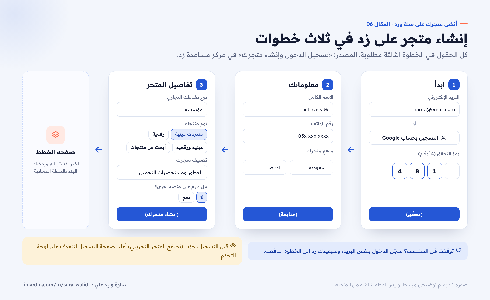
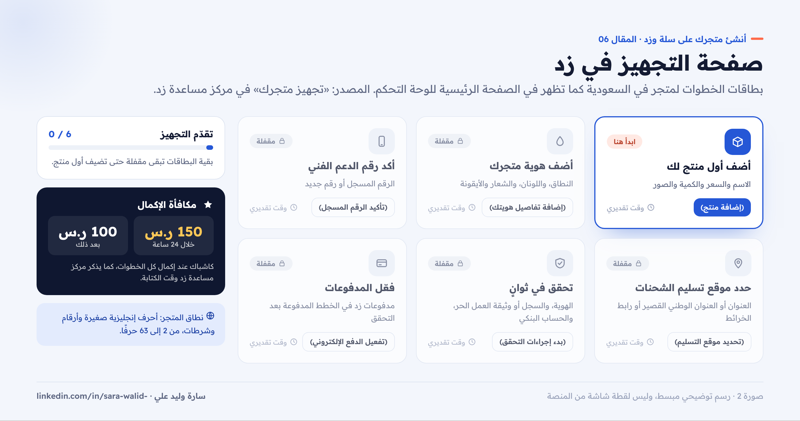
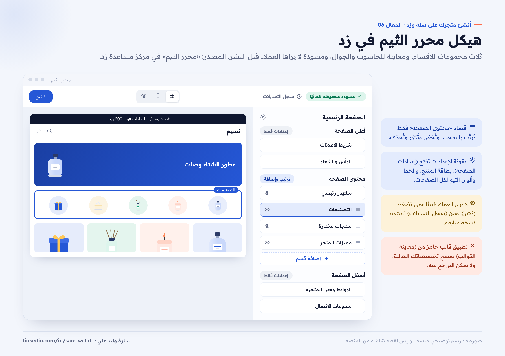
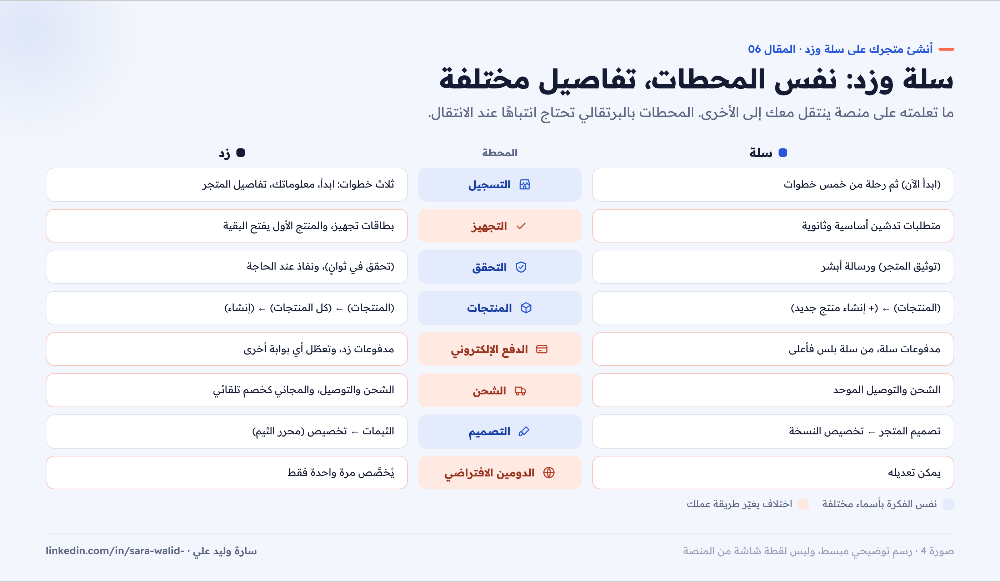
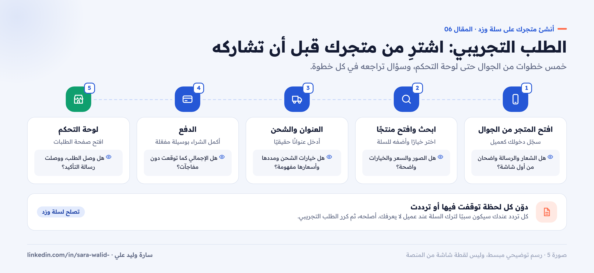

# 06 — نفس الرحلة على زد، وقائمة الإطلاق

**سلسلة: أنشئ متجرك على سلة وزد خطوة بخطوة · المقال 06**
بقلم: سارة وليد علي · مصممة منتجات رقمية UX/UI · نوفمبر 2026

**[اقرأ المقال على موقع السلسلة ←](https://sarawalidali.github.io/salla-zid-store-setup-guide/06-zid-and-launch.html)**

> **قبل القراءة:** الخطوات من مركز مساعدة زد كما كان في نوفمبر 2026. خطوات تجهيز المتجر في زد تختلف حسب الدولة والخطة، وهذا المقال يركز على المتاجر في السعودية.

---

## زد بعد ما تعلمته على سلة

إذا قرأت المقالات السابقة، فأنت تعرف المحطات: إنشاء المتجر، والتحقق، والمنتجات، والدفع، والشحن، والتصميم. زد تمر بنفس المحطات، لكن بأسماء وترتيب مختلفين. في هذا المقال سأشرح زد مختصرًا، ثم نختم السلسلة بقائمة إطلاق تصلح للمنصتين.

## 1. إنشاء المتجر في ثلاث خطوات

التسجيل في زد ثلاث خطوات، وتعرض لوحة جانبية تقدّمك فيها: ابدأ، ومعلوماتك، وتفاصيل المتجر ([تسجيل الدخول وإنشاء متجرك](https://help.zid.sa/ar/getting-started/sign-in)).

*صورة 1: ثلاث خطوات للتسجيل في زد، وما تدخله في كل خطوة.*

1. **ابدأ:** اضغط (إنشاء حساب جديد)، وأدخل بريدك ثم (إنشاء متجرك)، أو سجّل بحساب Google. أدخل رمز التحقق المكوّن من 4 أرقام، ثم (تحقّق).
2. **معلوماتك:** الاسم الكامل ورقم الهاتف، ثم رمز التحقق، ثم اختر الدولة والمدينة في **موقع متجرك**، واضغط (متابعة).
3. **تفاصيل المتجر:** كل الحقول مطلوبة:
    - نوع نشاطك التجاري.
    - نوع منتجك: منتجات عينية، أو رقمية، أو عينية ورقمية، أو «أبحث عن منتجات».
    - تصنيف متجرك.
    - هل تبيع على منصة أخرى؟ مثل سلة أو شوبيفاي.

بعد الضغط على (إنشاء متجرك) تُفتح صفحة الخطط لاختيار الاشتراك. وإذا توقفت قبل الإكمال، سجّل الدخول بنفس البريد وسيعيدك زد إلى الخطوة الناقصة.

**نصيحة:** قبل التسجيل، يمكنك استكشاف لوحة التحكم عبر (تصفح المتجر التجريبي) أعلى صفحة التسجيل.

## 2. صفحة التجهيز: بطاقات الخطوات

ما دام متجرك غير جاهز للبيع، تظهر في الصفحة الرئيسية للوحة التحكم **صفحة التجهيز**: بطاقات خطوات، ولكل بطاقة وقت تقديري، وعلامة عند الإكمال ([تجهيز متجرك](https://help.zid.sa/ar/getting-started/setup-guide)).

*صورة 2: بطاقات التجهيز لمتجر في السعودية، والخطوة التي تفتح بقية الخطوات.*

| البطاقة | ماذا تفعل |
| --- | --- |
| أضف أول منتج لك | (إضافة منتج): الاسم، والسعر، والكمية أو «مخزون غير محدود»، والوصف، والصور، ثم (حفظ) |
| أضف هوية متجرك | (إضافة تفاصيل هويتك): نطاق المتجر، واللون الأساسي والثانوي، والشعار والأيقونة |
| أكد رقم الدعم الفني | (تأكيد الرقم المسجل) أو (إضافة رقم جديد) |
| حدد موقع تسليم الشحنات | (تحديد موقع التسليم): بالعنوان، أو العنوان الوطني القصير، أو رابط خرائط قوقل، أو موقعك الحالي |
| تحقق في ثوانٍ | (بدء إجراءات التحقق): بيانات الهوية والسجل أو وثيقة العمل الحر والحساب البنكي |
| فعّل المدفوعات | تفعيل مدفوعات زد، في الخطط المدفوعة بعد التحقق |

**ابدأ بالمنتج:** في مساعد تجهيز المتجر، بقية الخطوات تبقى مقفلة حتى تضيف أول منتج.

**شروط نطاق المتجر في زد:** أحرف إنجليزية صغيرة وأرقام وشرطات فقط، ومن 2 إلى 63 حرفًا، ولا يبدأ أو ينتهي بشرطة.

**مكافأة الإكمال:** تذكر زد أنها تمنح كاشباك 150 ريالًا عند إكمال كل الخطوات خلال 24 ساعة من إنشاء الحساب، و100 ريال بعد ذلك.

## 3. المنتجات

**المسار:** (المنتجات) ← (كل المنتجات) ← (إنشاء) ([إضافة منتج](https://help.zid.sa/ar/products/add-product)).

أنواع المنتجات في زد:

| النوع | مثال |
| --- | --- |
| منتج فردي | منتج مادي أو خدمة، بخيارات أو بدونها |
| منتج مجمع | مجموعة ثابتة من منتجاتك بسعر واحد |
| قسيمة | أكواد لمنتج رقمي، مثل اشتراك أو بطاقة |
| ملفات رقمية | كتب إلكترونية، ودورات، وتصاميم |
| حزمة مرنة | يكوّن العميل الحزمة بنفسه من اختياراتك |

والأنواع غير الفردية تعتمد على باقتك.

**خطوات الإنشاء:**

1. في نافذة (إنشاء منتج جديد) اختر النوع.
2. املأ الحد الأدنى: اسم المنتج بالعربية والإنجليزية، و(سعر البيع)، و(رمز المنتج SKU).
3. أضف الصور والمخزون والتصنيفات والوصف وبيانات SEO.
4. راجع خيار (إظهار المنتج)، ثم اضغط (حفظ المنتج).

**ملاحظة:** بمجرد اختيار النوع يُنشأ المنتج كمسودة. وإذا غادرت دون حفظ يبقى في القائمة بحالة «مسودة».

## 4. الدفع

### مدفوعات زد

مدفوعات زد متاحة للمتاجر في السعودية والكويت، وتحتاج باقة تشمل الدفع الإلكتروني، ومنتجًا منشورًا واحدًا على الأقل له اسم وسعر وصورة ([تفعيل مدفوعات زد](https://help.zid.sa/ar/payments/activate-zid-payments)).

1. من (المدفوعات) اضغط (تفعيل الدفع الإلكتروني)، وراجع معلومات الحساب، ثم (التالي).
2. اختر متوسط عدد العمليات الشهرية وحجم المبيعات المتوقع، ثم الحساب البنكي، ثم (التالي).
3. اختر شبكات الدفع، ووافق على الشروط والأحكام، ثم (تفعيل).

قد تطلب زد التحقق من هوية المالك عبر **نفاذ**. وتراجع زد المستندات عادة خلال يومي عمل، وأيام الإيداع في السعودية: الأحد والثلاثاء والخميس.

**انتبه:** عند تفعيل مدفوعات زد تُعطَّل أي بوابة دفع أخرى تعمل في متجرك.

### في الخطة المجانية

الخطة المجانية «البداية» تتيح طرق دفع أساسية، مثل التحويل البنكي والدفع عند الاستلام ([أسعار زد](https://zid.sa/pricing/)). ومن بطاقة (تفعيل وسيلة الدفع) تضيف بيانات حسابك البنكي لاستقبال الإيداعات.

## 5. الشحن

صفحة (الشحن والتوصيل) تجمع طرق الشحن: **زد شب**، والشحن المخصص بحساب شركة شحنك، والتوصيل المحلي، والاستلام من الفرع. ومن زر (الإعدادات) فيها تضبط ([إعدادات الشحن](https://help.zid.sa/ar/logistics/settings)):

- **أولوية عرض طرق الشحن** في صفحة الدفع، حسب باقتك.
- **بيانات المرسل** لكل مخزن، وتظهر على بوالص الشحن.
- **قيود طرق الشحن** لإخفاء طريقة حسب المنتج أو الوزن أو المدينة، في باقات النمو والاحترافية والانتربرايز.
- **الشحن المجاني:** يُضبط كخصم تلقائي، وليس من إعدادات الشحن.

## 6. التصميم: الثيمات ومحرر الثيم

**المسار:** (المتجر الإلكتروني) ← (الثيمات) ([ثيمات المتجر](https://help.zid.sa/ar/online-store/themes)).

- يبدأ متجرك بثيم افتراضي.
- من (اكتشاف جميع الثيمات) تفتح سوق ثيمات زد لشراء ثيم أو إضافة ثيم مجاني.
- لتغيير الثيم: (تخصيص) لتجهيزه، ثم (معاينة)، ثم (تفعيل). ويظهر في متجرك فورًا.

### محرر الثيم

اضغط (تخصيص) لفتح المحرر في تبويب جديد ([محرر الثيم](https://help.zid.sa/ar/online-store/theme-editor)). أقسام الصفحة فيه ثلاث مجموعات:

*صورة 3: أقسام الصفحة في محرر الثيم، وأين تضيف وترتب، ومتى تظهر التعديلات للعملاء.*

| المجموعة | أمثلة | ماذا يمكنك |
| --- | --- | --- |
| أعلى الصفحة | الرأس، والشعار، وشريط الإعلانات | تعديل الإعدادات دون ترتيب |
| محتوى الصفحة | أقسام متن الصفحة الرئيسية | إضافة وترتيب وإخفاء وتكرار وحذف |
| أسفل الصفحة | الروابط، و«عن المتجر»، ومعلومات الاتصال | تعديل الإعدادات دون ترتيب |

- **إضافة قسم:** (إضافة قسم) ← ابحث باسمه ← (إضافة).
- **الإعدادات العامة:** أيقونة الإعدادات تفتح (إعدادات الصفحة): بطاقة المنتج، ونوع الخط، وألوان الثيم، وتسري على كل الصفحات.
- **المعاينة:** بدّل بين الحاسوب والجوال وملء الشاشة.
- **المسودة والنشر:** التعديلات تُحفظ تلقائيًا كمسودة ولا يراها العملاء حتى تضغط (نشر). ومن (سجل التعديلات) تستعيد أي نسخة سابقة.

**تحذير مهم:** تطبيق قالب جاهز من (معاينة القوالب) ثم (تطبيق) يمسح تخصيصاتك الحالية، ولا يمكن التراجع عنه.

## 7. الدومين

النطاق الافتراضي في زد بالشكل `اسم.zid.store`، ويمكنك تخصيص الجزء الذي يسبق `.zid.store` **مرة واحدة فقط** ([النطاقات](https://help.zid.sa/ar/store-settings/domains)).

**المسار:** (الإعدادات) ← (المتجر) ← (رابط المتجر الالكتروني).

لربط نطاق تملكه:

1. اضغط (ربط نطاق موجود)، وأدخل النطاق الأساسي مثل `example.com`، ثم (إنشاء).
2. انسخ خادمي الأسماء من بطاقة (خوادم الأسماء).
3. ضعهما مكان خوادم الأسماء الحالية في لوحة جهة تسجيل النطاق.
4. ارجع واضغط (التحقق)، ثم (تفعيل) عندما تصبح الحالة «جاهز للتفعيل».

قد يستغرق تحديث خوادم الأسماء حتى 72 ساعة. وزد لا تسجّل نطاقات `.sa`، فتسجيلها يكون لدى SaudiNIC ثم تربطها.

## سلة وزد جنبًا إلى جنب

| المحطة | سلة | زد |
| --- | --- | --- |
| التسجيل | (ابدأ الآن) ثم رحلة من خمس خطوات | ثلاث خطوات: ابدأ، معلوماتك، تفاصيل المتجر |
| التجهيز | متطلبات تدشين أساسية وثانوية | بطاقات التجهيز في الصفحة الرئيسية |
| التحقق | (توثيق المتجر) ورسالة أبشر | (تحقق في ثوانٍ)، ونفاذ عند الحاجة |
| المنتجات | (المنتجات) ← (+ إنشاء منتج جديد) | (المنتجات) ← (كل المنتجات) ← (إنشاء) |
| الدفع الإلكتروني | مدفوعات سلة، من سلة بلس فأعلى | مدفوعات زد، في الباقات التي تشمل الدفع الإلكتروني |
| الشحن | الشحن والتوصيل الموحد، وبوليصات سلة | الشحن والتوصيل، وزد شب |
| التصميم | تصميم المتجر ← تخصيص النسخة | الثيمات ← تخصيص (محرر الثيم) |
| الدومين الافتراضي | يمكن تعديله | يُخصَّص مرة واحدة فقط |

*صورة 4: نفس المحطات على المنصتين، وأين يختلف الترتيب.*

## قائمة الإطلاق: قبل أن تشارك رابط متجرك

هذه القائمة تصلح لسلة وزد. لا تنشر رابط متجرك قبل أن تمر عليها كاملة.

### جرّب طلبًا حقيقيًا

زد تنصح صراحة بأن تشتري من متجرك قبل مشاركته لتختبر رحلة العميل ([تجهيز متجرك](https://help.zid.sa/ar/getting-started/setup-guide))، وهذه أفضل نصيحة في السلسلة كلها:

1. افتح متجرك من الجوال، وسجّل دخولك كعميل.
2. ابحث عن منتج، وافتحه، واختر خيارًا، وأضفه للسلة.
3. أكمل الشراء: العنوان، والشحن، والدفع.
4. تأكد أن الطلب ظهر في صفحة الطلبات في لوحة التحكم.
5. لاحظ كل لحظة توقفت فيها أو ترددت، وأصلحها.

*صورة 5: خمس خطوات لطلب تجريبي، وما تراجعه في كل خطوة.*

### القائمة النهائية

**المتجر والتوثيق**

- [ ] المتجر موثق، أو طلب التوثيق والتحقق مقبول.
- [ ] الباقة مناسبة لطرق الدفع وأنواع المنتجات التي تحتاجها.

**المنتجات**

- [ ] أول خمسة منتجات على الأقل بصور متناسقة وبيانات كاملة.
- [ ] الكميات والأوزان مُدخلة، والخيارات لها كميات.
- [ ] التصنيفات ظاهرة في قائمة المتجر.

**الدفع والشحن**

- [ ] طريقة دفع واحدة على الأقل تعمل، وجربتها.
- [ ] شركة شحن واحدة على الأقل مفعلة بأسعار واضحة.
- [ ] شرط الشحن المجاني مكتوب في المتجر إن وُجد.

**التصميم والثقة**

- [ ] الشعار والأيقونة واللون والخط مضبوطة.
- [ ] الصفحة الرئيسية مراجعة على الجوال.
- [ ] وسيلة تواصل واحدة على الأقل ظاهرة.
- [ ] صفحات السياسات موجودة: الاستبدال والاسترجاع، والشحن، والخصوصية.
- [ ] الدومين مضبوط، والتجديد التلقائي مفعل.

**الاختبار**

- [ ] أجريت طلبًا تجريبيًا كاملًا من الجوال، وظهر في لوحة التحكم.

## الخلاصة

المنصتان تجعلان إنشاء المتجر ممكنًا في يوم واحد. لكن الفرق بين متجر يعمل ومتجر يبيع في التفاصيل: مستندات جاهزة تمنع رفض التوثيق، ومنتج بصور واضحة ووصف مفيد، وشحن بلا مفاجآت، وتصميم يوصل العميل للمنتج بأقل جهد. ابدأ بسيطًا، وأطلق بخمسة منتجات، ثم حسّن متجرك بناء على ما يفعله عملاؤك فعلًا.

إذا كان عندك سؤال عن خطوة لم تتضح، اكتبه في التعليقات، وسأضيف شرحه في تحديث قادم للسلسلة.

## المصادر

- [زد: تسجيل الدخول وإنشاء متجرك](https://help.zid.sa/ar/getting-started/sign-in)
- [زد: تجهيز متجرك](https://help.zid.sa/ar/getting-started/setup-guide)
- [زد: إضافة منتج](https://help.zid.sa/ar/products/add-product)
- [زد: تفعيل مدفوعات زد](https://help.zid.sa/ar/payments/activate-zid-payments)
- [زد: إعدادات الشحن](https://help.zid.sa/ar/logistics/settings)
- [زد: ثيمات المتجر](https://help.zid.sa/ar/online-store/themes)
- [زد: محرر الثيم](https://help.zid.sa/ar/online-store/theme-editor)
- [زد: النطاقات](https://help.zid.sa/ar/store-settings/domains)
- [زد: الأسعار](https://zid.sa/pricing/)

---

**المقال السابق:** [05 — تخصيص تصميم متجرك](../05-design-customization/README.md) · **العودة إلى:** [فهرس السلسلة](../../README.md)

